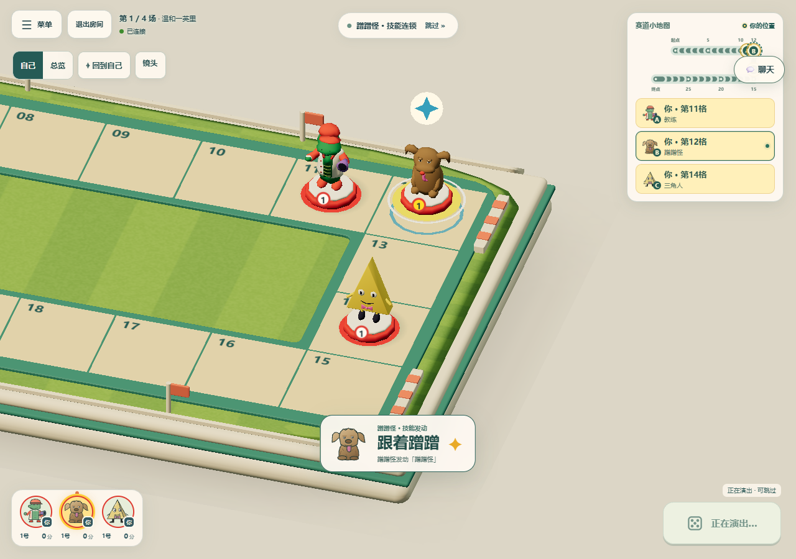
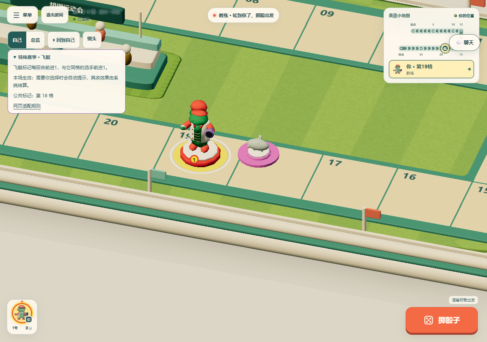
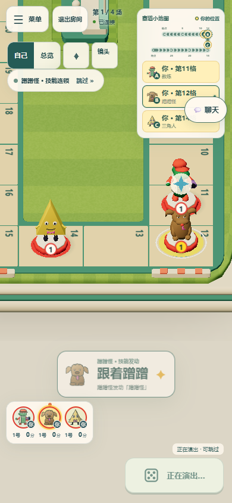
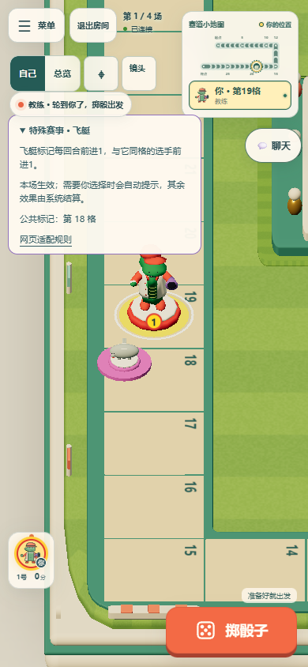

# 场地角色跟拍与连续技能镜头

2026-10-26。本次只修改客户端镜头及技能横幅的构图，沿用服务端确认的事件、播放顺序、棋子位置和规则结算。

## 修复与观赏效果

- `event-marker` 的移动对象是场地公共角色，没有玩家选手 ID。原镜头只从选手和选手移动中取位置，得到空集合后按第 0 格构图，因而飞艇每次移动前会回到起点。现在直接取该事件的 `before/after`；场地骰则使用随播放队列回溯后的公共角色位置。游荡巨口也独立定位。
- 同一回合内已经确认的技能、移动、绊倒和恢复可以组成共同镜头：最多查看当前及后续共 6 个片段、自然时长合计不超过 6.5 秒、最多 3 位选手。按实际地图与视口拟合，拉远幅度和最低缩放均有限制；相距太远就另起镜头。
- 共同镜头覆盖每段移动路径，并持续保留到这组片段播完，避免每个技能都重新推近再拉远。未来位置只用于镜头规划副本，棋子、技能高亮和提示仍按当前片段依次播放。
- 骰子、下一回合、开场和结果不跨界合镜；尚未确认的选择或后续结算不做预测。手动平移、回到自己、自动观看开关和总览沿用原优先级。
- 共同镜头中的技能横幅放在操作区上方，避免遮住同时展示的角色头部。

## 验证

- `pnpm typecheck`：通过。
- `pnpm exec tsx --test tests/camera.test.ts tests/presentation.test.ts tests/presentation-events.test.ts tests/scene-math.test.ts`：81/81 通过，包含 NPC 定位、播放前位置回溯、共同镜头保持、远距离/骰子/回合边界和既有相机步长限制。
- `pnpm build`：客户端、Node 服务端和浏览器主机包通过；保留原有体积提示。
- `pnpm exec wrangler deploy --dry-run`：通过，仅验证打包。
- `CI=true` 软件 WebGL 浏览器：13 项定向用例均已通过。新增 5 项用真实引擎生成事件，在桌面 1280×900、手机视口 390×844 验证飞艇连续两次移动、三角人→蹭蹭怪连锁共同构图、总览/手动拖动/回到自己优先级，以及减少动效下的场地骰。断言包括实际镜头轨迹不绕起点、两角色模型边界入镜以及技能横幅不遮挡模型。
- 另 8 项覆盖既有跟拍停留、宿敌骰、游荡巨口与场地骰、交换、传送和手机同时移动/跳过回归。先用 `--list` 确认筛选。CI 增加 5 项短镜头回归和相机单元测试，镜头结果在后续浏览器套件清理输出前上传独立 artifact。

验收中，手机视口的飞艇镜头可能从一开始就已经稳定，DOM 记录只有一条；删除了“必须记录多帧”这一不成立的假设，保留真实位置、端点与不绕起点断言。首轮截图还发现旧技能横幅遮挡角色，调整后新增投影边界与横幅不相交断言。旧 `three-scene` fixture 的 3 项检查初次在读身份缓存时失败，已更新为带后端的房间码和缓存键，复验 3/3 通过。手机手动拖动检查使用 DOM 命中验证，确保从棋盘画布而非覆盖其上的骰子画布发起手势，复验通过。

以下是最终代码的真实浏览器截图。原始相机记录附加到测试报告，本地保留在 `tmp/camera-check-results` 和 `tmp/camera-phone-final`，远端在 `camera-choreography` artifact。手机使用桌面浏览器的手机视口与软件 WebGL，未声称实体手机 GPU 验证。本地没有重复八人长局，远端仍采用现有默认的一场八人冒烟；PR、远端检查、预览和生产状态分别报告。

| 视口 | 连续技能共同镜头 | 飞艇事件后的场地位置 |
| --- | --- | --- |
| 桌面 |  |  |
| 手机 |  |  |
