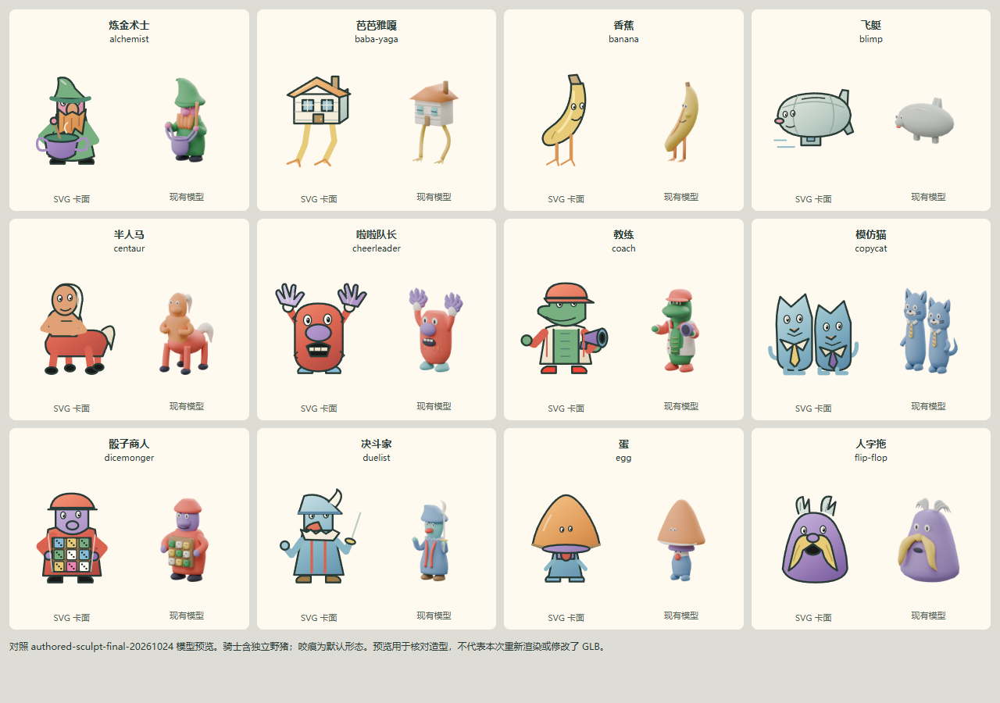

# 卡面与现有 3D 模型一致性核验

2026-10-25。在卡面精修提交 `b2f3b53` 上，逐一对照 151 位可玩角色的实时 SVG、已交付模型预览及模型识别说明，修正 139 位角色的形体、服装、主色或道具。保留纸感插画、卡框与交互；12 位已符合模型身份的角色保留原画。

本批依据 `authored-sculpt-final-20261024` 模型；未修改 GLB、模型预览、模型清单或游戏规则。卡面允许绘本比例、姿势和光照差异，但角色种类与主要识别特征应对应当前棋子。骑士在运行时另附野猪坐骑，因此对照页同时展示两者；咬痕展示默认形态。

## 逐角色对照

每格左侧为修正后的实际 SVG，右侧为仓库已有模型预览。这里没有重新渲染 GLB。逐项说明见 [audit.json](audit.json)。

| 角色包 | 人数 | 对照图 |
| --- | ---: | --- |
| 原版 | 36 | [1–12](original-0.png) · [13–24](original-1.png) · [25–36](original-2.png) |
| Second Wind | 36 | [1–12](second-wind-0.png) · [13–24](second-wind-1.png) · [25–36](second-wind-2.png) |
| Extra Mile | 31 | [1–12](extra-mile-0.png) · [13–24](extra-mile-1.png) · [25–31](extra-mile-2.png) |
| Leaf | 18 | [1–12](leaf-0.png) · [13–18](leaf-1.png) |
| Wurstii | 30 | [1–12](wurstii-0.png) · [13–24](wurstii-1.png) · [25–30](wurstii-2.png) |



## 实际页面

[桌面选牌，1440 × 1000](product-desktop.png) · [手机选牌，390 × 844](product-mobile.png) · [手机详情](product-detail-mobile.png)。本批截图来自独立检出的生产构建；选牌页使用默认两个角色包，72 张，全部 151 位另由上述对照页覆盖。

## 验证与复现

在 `b2f3b53` 加本批卡面改动的隔离检出上完成：

- `pnpm typecheck`、`pnpm build:avatars`、`pnpm build` 均通过；生产构建保留既有大包体提示。
- `pnpm exec tsx --test tests/avatars.test.ts tests/character-context.test.ts tests/egg-info.test.ts tests/character-abilities.test.ts`：24/24 通过。覆盖 151 个独特矢量画稿、302 个重复实例的 ID/引用隔离，以及 115 份公开 SVG 与实时组件一致性。最大公开 SVG 为 4778 字节，低于既有 9000 字节预算。
- `pnpm exec playwright test tests/browser/athlete-feedback-ui.spec.ts tests/browser/egg-character-info.spec.ts --grep 'avatar details|current ability layout'`：2/2 通过。覆盖当前操控者、复制/失效能力、同卡多个实例及桌面/手机详情布局。这是本地验证，现有 CI 不包含 `athlete-feedback-ui.spec.ts`。
- 浏览器逐图测量 151 个画稿的变换后图形和描边边界：0 越界，最小边距约 4.01 个 viewBox 单位。桌面 1440px 与手机 390px 实际选牌页无横向溢出。几何检查不代表角色身份核验，造型一致性来自逐图对照。

生成可重复查看的并排 HTML：

```sh
pnpm exec tsx scripts/portrait-reference-gallery.ts
```

输出在 `output/playwright/portrait-reference-gallery/index.html`，包含内嵌 SVG 和预览图，可直接在浏览器打开；`references.json` 记录模型预览来源。浏览器测试初次因验证检出位于 `.local` 隐藏目录而遭静态服务拒绝，换普通目录入口后通过，未因此修改产品代码。

本批没有重跑完整规则套件，也没有进行实体手机 GPU 测试。
