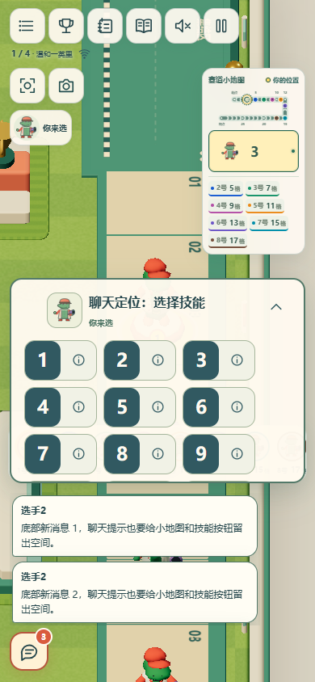
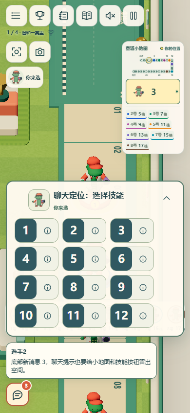
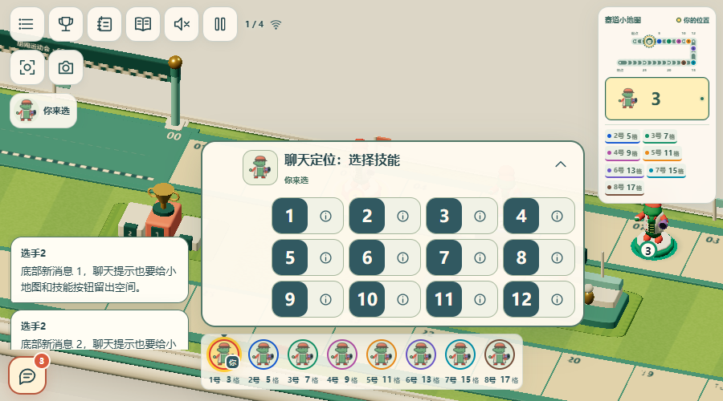
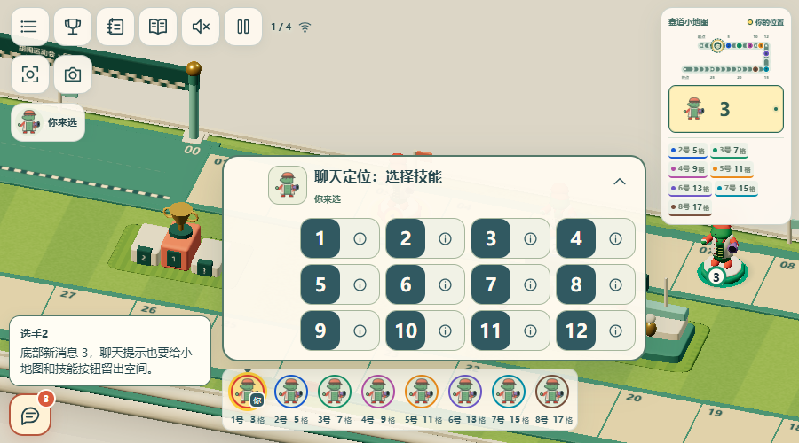
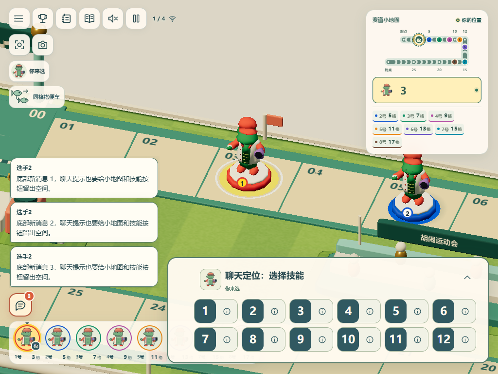
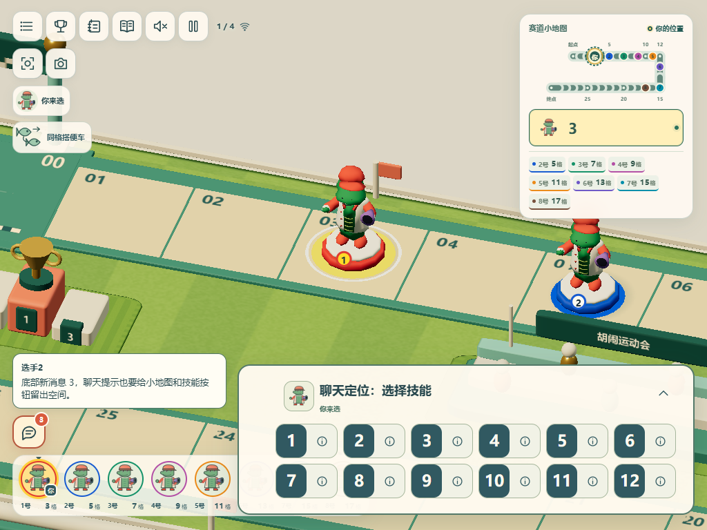
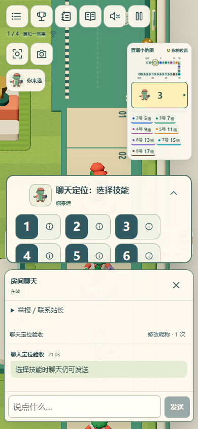

# 海外聊天预览与记录显示

2026-11-06。基线 `1416de8`；before 截图由独立的原主分支 checkout 构建并运行原浏览器脚本得到。

海外新消息合并为聊天按钮附近的一条最新预览；完整历史、发送者、时间、未读计数、消息 ID、顺序及重连去重保留。消息列表不再显示 `#id`，举报说明改用发送者和时间定位。复用原有聊天停靠区和安全区域，不增加新的常驻说明。国内版的固定随机昵称和无交流界面保持不变。

## 本地结果

- 相关聊天、客户端合并、网络、站点隔离测试 **46/46** 通过。
- `tests/browser/chat-layout.spec.ts` **12/12** 通过：9 组比赛布局（1280、1024、768、820、1180、1366、390、320 和 900 横屏）及 1440 / 390 / 844 候场聊天。验证预览紧邻入口、批量消息合并、完整历史无编号、刷新顺序不变、小地图和技能操作可见、面板开关、窗口变化及模拟软键盘。
- 国内 `tests/browser/site-editions.spec.ts` **3/3** 通过：固定随机昵称、伪造存储/URL、主机和观战、刷新、横屏操作、国内无聊天；更新了旧脚本中已过期的按钮名称。
- `npm run typecheck:release` 和 `npm run build`（cn Node + global Worker 前端）通过。
- `npx tsc --noEmit` 仍有两处现有 TS7016：部署测试引用 `cloudflare-retry.mjs`、`cloudflare-command.mjs` 没有声明。已在未修改的 `1416de8` checkout 复现相同的两项错误，本 PR 未改部署文件。
- 没有远端 CI 手动触发、发布或服务器配置变更。

以上使用 Windows 上的 Edge / Playwright。触摸和键盘高度为模拟，未在真实手机、iOS Safari、真实系统键盘或移动网络上验证。

| 场景 | 修改前 | 修改后 |
| --- | --- | --- |
| 手机新消息 |  |  |
| 横屏新消息 |  |  |
| 桌面新消息 |  |  |
| 聊天记录去编号 |  |  |

补充：[手机模拟键盘](after-phone-keyboard.png)、[横屏模拟键盘](after-landscape-keyboard.png)、[候场完整记录](after-lobby-390-history.png)。
