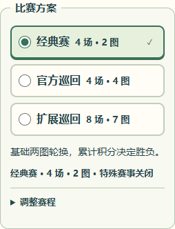
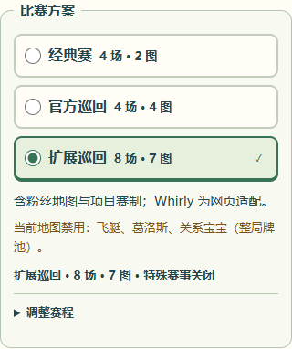
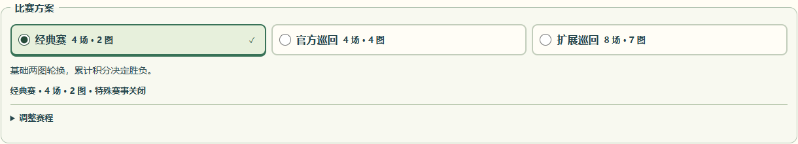

# 比赛方案选择与赛程设置验收

2026-11-05，本地 Windows / Edge 无头浏览器。手机尺寸为视口模拟，未在实体手机或 iPhone Safari 上验证。

## 展示与交互

- 三个原生单选项直接显示名称、场数和地图数；选中项显示绿色边框、背景及勾选标识，支持方向键选择。每项高度约 48px。
- 仅当前方案显示一句简短说明。Whirly 网页适配、扩展巡回的粉丝地图与项目赛制，以及当前地图的具体禁用角色保持可见。
- 详细编辑统一进入「调整赛程」，默认收起。添加地图、特殊赛事和逐场积分继续按需展开；完整规则进入既有「怎么玩」弹窗。
- 展开设置、地图库、特殊赛事、积分预览或规则均不修改配置。实际编辑场数、地图顺序或赛事后标记为自定义；切换预设保留角色包开关和赛事设置。
- 缩短场数保留原地图列表和赛事场次，说明具体冲突并阻止提交。越界赛事仍显示为可取消的勾选项，也可恢复原场数；不会自动裁剪。
- 房主在可配置阶段可以保存；非房主、观战者及比赛中锁定的房主只能展开查看。终局仍可编辑下一局设置。

## 本地验证

| 检查 | 结果 |
| --- | --- |
| `pnpm typecheck:release` | 通过 |
| `pnpm typecheck` | 通过，包含测试与 Worker |
| `pnpm build` | 通过，生成 Node / Worker 前端产物 |
| 下列 5 个相关单元测试文件 | 112/112 通过 |
| 配置浏览器专项 | 13 项通过；覆盖布局、预设实际建房与恢复、自定义地图编辑、特殊赛事、冲突修复、查看不改设置、角色包独立开关、权限及练习/人机终局配置 |
| `git diff --check` | 通过 |

单元回归命令：

```powershell
pnpm exec tsx --test tests/competition.test.ts tests/special-events.test.ts tests/map-rules.test.ts tests/room-config-capacity.test.ts tests/three-player-mode.test.ts
```

浏览器专项命令：

```powershell
pnpm exec playwright test tests/browser/competition.spec.ts tests/browser/special-events.spec.ts tests/browser/new-track-scenes.spec.ts --grep 'home shows|compact radios|shortening a match|switching presets|opening settings|guest and spectator|tour can be created|rematch returns|special event setup|setup exposes'
```

视口覆盖 320、360、390、430、768、1440px，均无横向溢出。原预设、默认值、场次、积分、共享校验、引擎和网络协议保持原实现；未修改 CI 工作流，也未运行额外远端套件。长时间多人完整对局的浏览器用例仅更新了设置入口选择器，本次未重跑；4/6/8 场的积分与冻结赛程由相关单元回归覆盖。

## 界面证据

### 手机默认经典赛



### 手机扩展巡回



### 桌面


