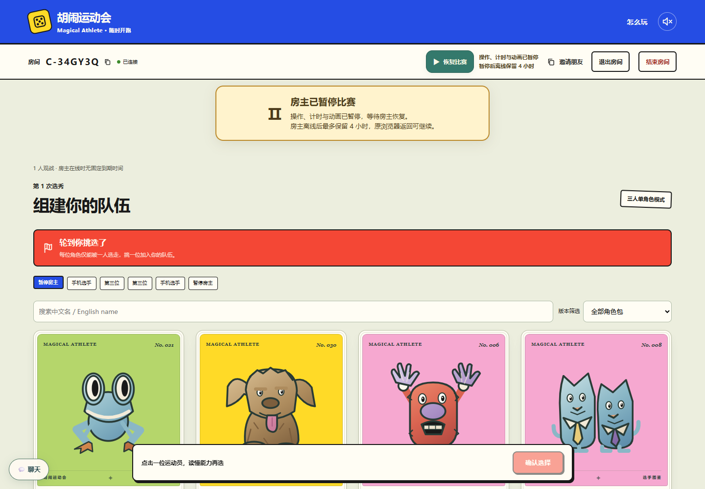
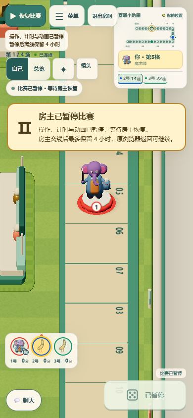
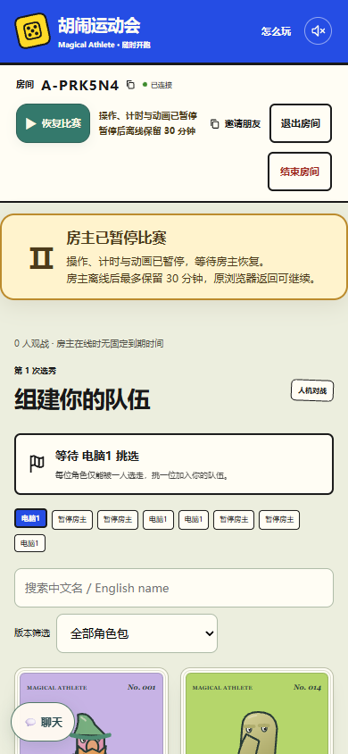

# 暂停按钮直接生效

2026-10-28。本次按用户最终要求仅调整暂停的交互与说明。点击“暂停比赛”直接发送暂停操作，不再打开浏览器确认弹窗；按钮旁显示冻结操作、计时与动画的说明，并通过 `aria-describedby` 关联。

原保留时间规则保持：真人房暂停后离线最多 4 小时、AI 房 30 分钟、练习房 10 分钟。共享期限、服务端、存档和续赛逻辑没有修改；完整规则仍见 [README](../../../README.md)。

## 本地验证

| 检查 | 结果 |
| --- | --- |
| `pnpm exec tsx --test tests/room-management.test.ts tests/room-lifecycle.test.ts tests/room-pause.test.ts` | 44/44，通过，沿用原时间边界测试 |
| `pnpm exec playwright test -c playwright.room-management.config.ts` | 8/8，通过；本地 HTTPS Worker 与 Node，桌面与手机，三种模式 |
| `pnpm exec playwright test tests/browser/room-pause.spec.ts` | 5/5，通过；选卡、骰面阅读、移动、决斗、六骰与入场暂停 |
| `pnpm typecheck` | 通过 |
| `pnpm build` | Node 与浏览器产物构建通过，保留已有的大 chunk 提示 |
| `git diff --check` | 通过 |

暂停与恢复的浏览器检查会捕获并拒绝意外原生弹窗，验证单次点击生效；踢人仍保留原确认流程。提示的 4 小时、30 分钟、10 分钟与退出说明分别核对。手机检查包含横向溢出、恢复按钮和说明可见性，以及说明与比赛状态、相机入口、暂停公告之间不重叠；最终截图另经目视核对。

新增模式提示检查位于已有的本地显式配置，未修改 CI 工作流、范围脚本或默认远端测试选择，也未手动调度额外远端工作流。没有部署或合并。

## CI 播放控制修复

[Checks160 的失败日志](https://github.com/qiuh23/magical-athlete-online/actions/runs/40709850813/job/122891836643)显示，前置检查已通过，八人单场第 38 步在点击“跳过动画”时超时。失败附件中无页面错误，按钮始终可见、可用，中心命中按钮；动画仍在继续。点击已通过稳定性检查，停在 Chromium 的自动滚动步骤，未见暂停说明遮挡按钮的证据。

固定在视口内的跳过按钮改用 Playwright 已锁定版本支持的 `scroll: 'none'`，仍执行可见性、可用性、稳定性及遮挡检查，并发送真实输入。原单次点击 8 秒、总计 20 秒预算保持；没有强制点击或脚本派发点击。

原 helper 会把屏幕外的按钮滚入并点击，新增边界回归已先在旧代码上复现。修正后使用 CI 软件渲染配置运行现有 helper 入口，11/11 通过，包含真实输入、屏幕外拒绝、启用但被遮挡的按钮拒绝、自然消失与诊断超时；类型检查和差异检查通过。此次补充仅修改检查辅助代码和两项必要回归，应用实现及时间规则保持原样，CI 工作流和选择脚本未改。

`CI=true RELAY_SMOKE=1 pnpm exec playwright test -c playwright.relay.config.ts --grep "server authority 8 independent"`：只运行一场，1/1 通过，约 1.7 分钟。覆盖真实操作 ACK、房主/客人恢复、私有视图和桌面/手机布局；48 次播放检查中完成 40 次真实跳过点击，其余可自然结束，最长处理 3009ms。未增加八人场数或修改既有远端预算。

[Checks161](https://github.com/qiuh23/magical-athlete-online/actions/runs/40713197660/job/122903734757)另外捕获手机模拟键盘升起时的布局测量时序：键盘偏移变量先更新，聊天高度由 ResizeObserver 稍后发布，原检查立即读取中间尺寸，误报技能面板与小地图重叠；失败截图已恢复正常。原代码在本地相同 CI 配置连续 3 次复现，改为轮询原有“不与聊天和小地图重叠”的几何断言后连续 3 次通过。实际按钮点击命中检查、应用布局及时间预算保持，未增加重试或新测试场次。

随后按远端原命令联合运行 `interaction-feedback.spec.ts` 与 `chat-layout.spec.ts`，9/9 通过（40.9 秒），覆盖桌面、小桌面、手机、短横屏、聊天收放、技能选项变化与键盘偏移。

## 界面证据

桌面选秀：按钮旁直接显示说明。

手机比赛：暂停说明与比赛状态、相机入口分别留位。

手机 AI 房：继续显示原有的 30 分钟。

