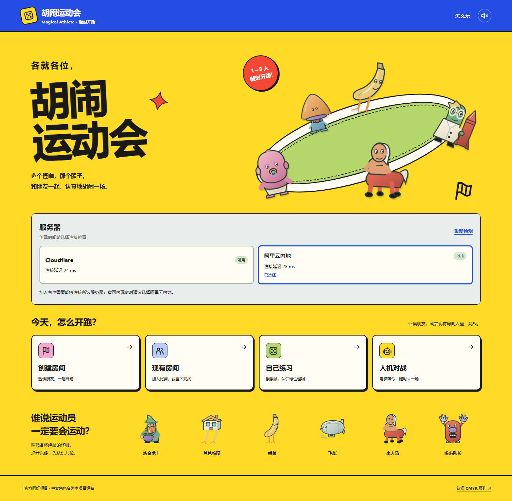
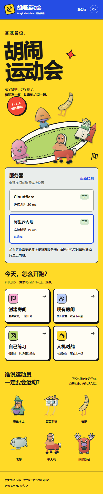

# 双后端验证

2026-10-25，本地验证与生产部署分开记录；云端最新状态见 [阿里云接入记录](../../aliyun-readiness.md)。

- 类型检查、Node/Worker 两种前端构建、Worker dry-run 通过。
- 仓库 CI 固定六组规则/后端单元检查共 587 次测试执行通过（部分文件在不同必需组重复执行，不等于 587 个独立用例）。
- 本次后端选择、协议、隔离、旧码、建房回执重试、配额、SQLite 重启恢复、返回房间和镜头缓存针对性检查 48 项通过。
- 选服 UI 7 项通过：HTTP 与实时连接同时检测、CF 不可达时选 Aliyun、未部署、两端失败、偏好和手选保持、重新读取部署配置、初检期间禁止提交。1440/390 布局无横向溢出。
- Worker 与 Node 两端分别使用两个独立浏览器会话，从另一网页入口加入目标房间，验证建房、加入、准备操作、聊天、断网重连及刷新身份恢复。使用本地真实 Worker WebSocket 和 Node Socket.IO，2 项通过；两端练习/AI 启动另 2 项通过。
- 仓库必需短浏览器回归 24 项通过：首页配置、路线骰面、赛前地图、特殊事件、房主缺席生命周期及代表性 Whirly/Bridges 画面；既有首页入口 5 项通过。
- 房间目录移动端加入/观战通过；快照汇总及回放诊断 9 项通过；代表性八人一场（含房主与客人恢复、隐私、布局）通过。没有追加全角色、全地图或长时间压力矩阵。

首轮失败与修复：跨入口加入在探测尚未结束时误报失败，已加提交闸门并通过专项回归；新外部房间码使旧邀请断言失配，已更新预期并通过八人检查。主动断网时本地 Worker 打印 `Network connection lost`，恢复断言仍通过。

下列截图为**本地 UI、模拟两端可用状态**，不能证明阿里云已公开部署或国内网络实测通过：

