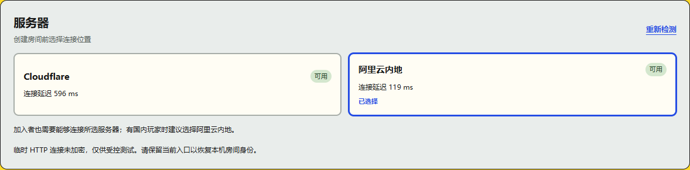
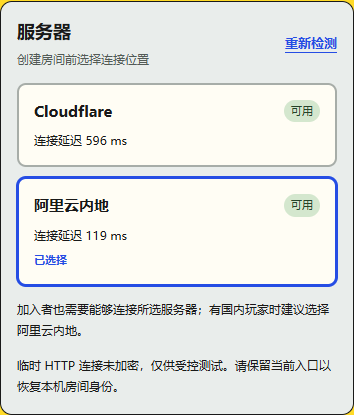
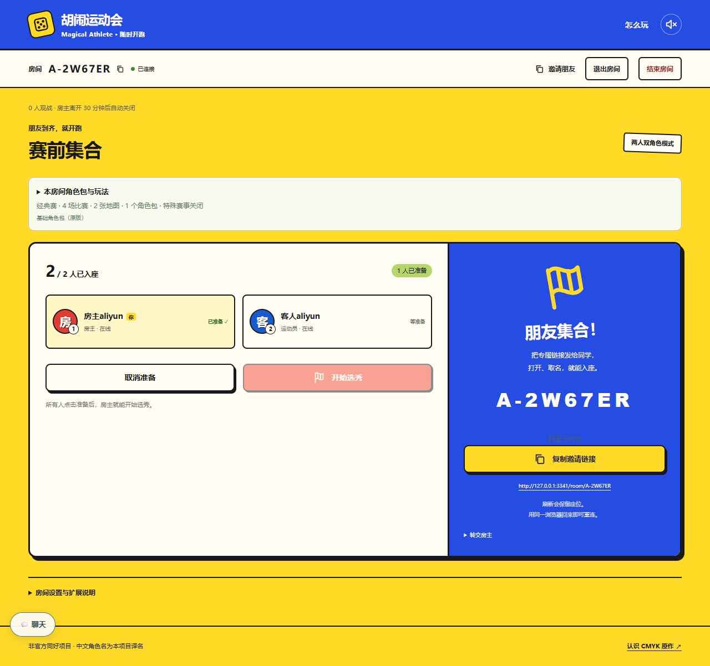

# 双后端验证

## HTTP 追加验证

36 项针对性单元、类型检查、构建和 Worker dry-run、8 项选服/桌面手机及 3 项真实非安全上下文 HTTP 浏览器检查通过。实际 IP HTTP + 正式 CF HTTPS 的双入口检查 14 项通过：各后端双会话、跨入口邀请、私密目录、准备、双向聊天、断线和刷新恢复、练习合法掷骰、AI 启动。4 个测试房全部关闭，页面异常为 0。另一次实际 HTTP 服务重启保留两身份、准备状态、聊天和创建回执，测试房关闭。

以下是**实际 ECS IP HTTP 的受控网络截图**，两端延迟为本次实测，不代表国内所有网络。HTTP 仅限来源 IP 白名单；正式域名 HTTPS 仍待备案。

远程检查 #119 的新 HTTP 与既有短检查通过，八人测试因旧脚本使用六位裸码触发正确的归属确认而失败；现改为保留完整 C- 邀请 URL，未放松产品逻辑。最终 CI 以 PR #23 当前提交为准。

## 前次双后端验证记录

2026-10-25，本地验证与生产部署分开记录；云端最新状态见 [阿里云接入记录](../../aliyun-readiness.md)。

- 类型检查、Node/Worker 两种前端构建、Worker dry-run 通过。
- 仓库 CI 固定六组规则/后端单元检查共 587 次测试执行通过（部分文件在不同必需组重复执行，不等于 587 个独立用例）。
- 本次后端选择、协议、隔离、旧码、建房回执重试、配额、SQLite 重启恢复、返回房间和镜头缓存针对性检查 48 项通过；随后补充受控模式不得误报公网开放的回归，服务端 5 项通过。
- 选服 UI 7 项通过：HTTP 与实时连接同时检测、CF 不可达时选 Aliyun、未部署、两端失败、偏好和手选保持、重新读取部署配置、初检期间禁止提交。1440/390 布局无横向溢出。
- Worker 与 Node 两端分别使用两个独立浏览器会话，从另一网页入口加入目标房间，验证建房、加入、准备操作、聊天、断网重连及刷新身份恢复。使用本地真实 Worker WebSocket 和 Node Socket.IO，2 项通过；两端练习/AI 启动另 2 项通过。
- 仓库必需短浏览器回归 24 项通过：首页配置、路线骰面、赛前地图、特殊事件、房主缺席生命周期及代表性 Whirly/Bridges 画面；既有首页入口 5 项通过。
- 房间目录移动端加入/观战通过；快照汇总及回放诊断 9 项通过；代表性八人一场（含房主与客人恢复、隐私、布局）通过。没有追加全角色、全地图或长时间压力矩阵。

首轮失败与修复：跨入口加入在探测尚未结束时误报失败，已加提交闸门并通过专项回归；新外部房间码使旧邀请断言失配，已更新预期并通过八人检查。主动断网时本地 Worker 打印 `Network connection lost`，恢复断言仍通过。

远程 CI 首次 PR 检查的八人用例暴露测试等待问题，其余步骤通过：8 个 SwiftShader 页面下采样调度间隔达到 4～6 秒，原 1 秒点击稳定等待不足。现在对当前按钮保留标准可操作性检查并给 8 秒预算，总等待仍为 20 秒，不强制点击；按钮自然消失时及时结束，既有短失败诊断不放宽。另将批次末卡交给既有服务端自动分配，避免测试争抢已结束的选秀操作。修复后诊断 9 项、8 人一场及类型检查通过；新提交的远程检查状态以 PR Checks 为准。

下列截图为**本地 UI、模拟两端可用状态**，不能证明阿里云已公开部署或国内网络实测通过：

实际 ECS 应用 `a8c43bd` 的受控验证通过：两个 TLS 实时客户端完成建房/加入/合法掷骰/聊天，服务重启和自动恢复保持 SQLite 状态，在线备份完整性通过；真正从 ECS 加载网页/资源的浏览器跨入口会话与练习/AI 启动 2 项通过。TLS 使用显式信任的测试 CA，浏览器使用 SSH 内 HTTP，未验收正式公网 HTTPS 或国内真实网络。

