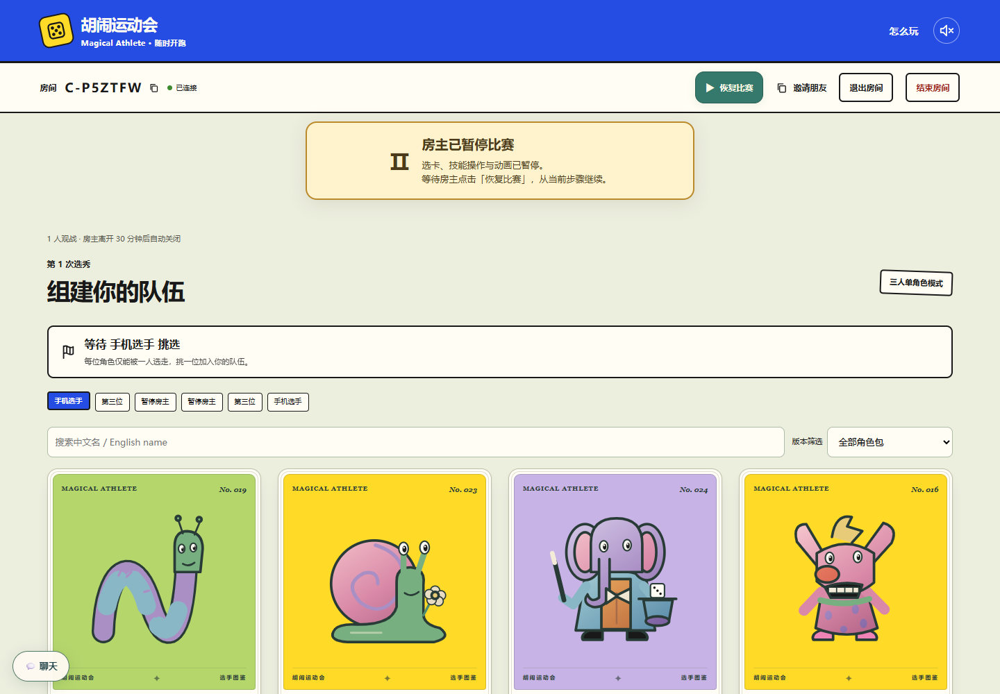
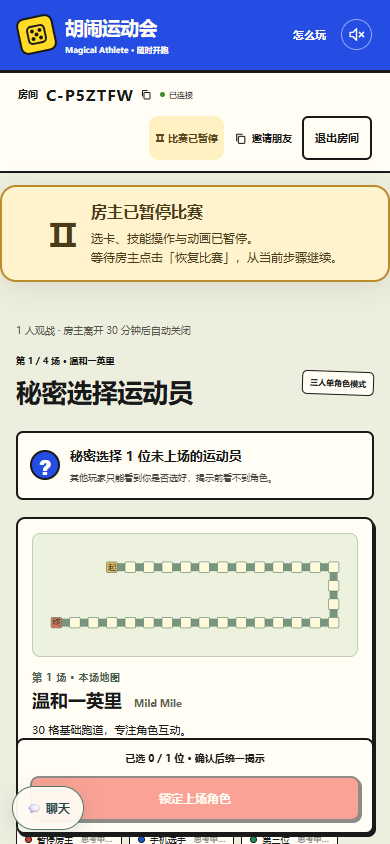
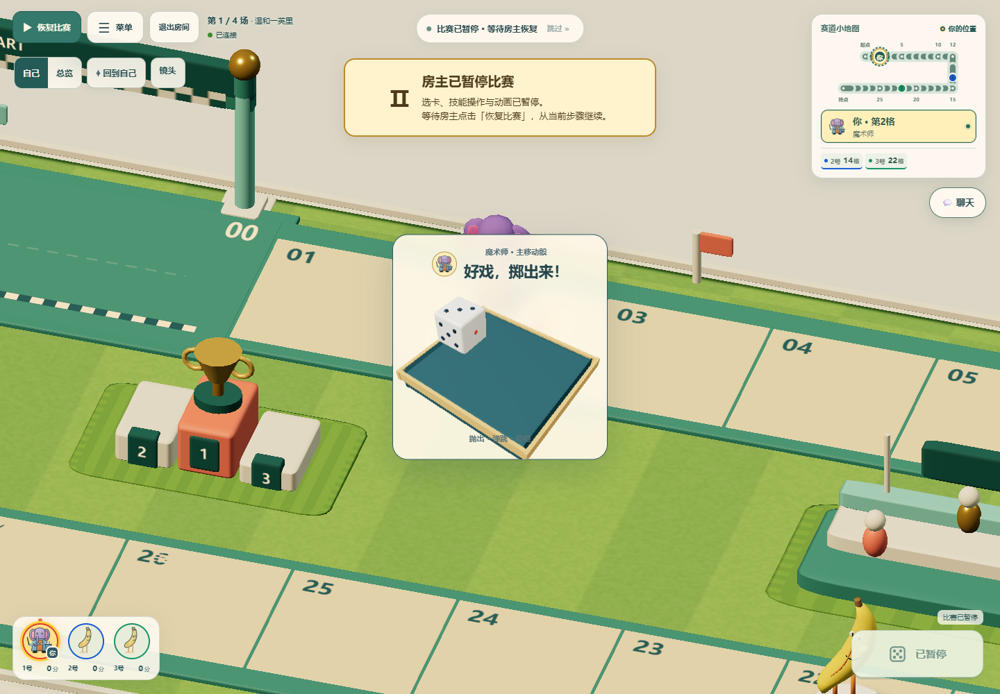
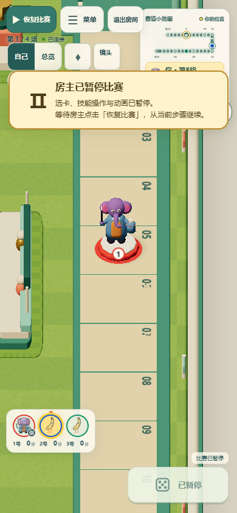

# 房主暂停与恢复

房主在选秀、秘密选择上场角色和比赛画面顶部均有常驻入口。大厅提前显示此功能，开局后可用；其他选手与观战者看到“房主可暂停”。暂停后显示黄色提示与绿色恢复按钮，技能选项仍可查看，操作按钮禁用。

## 状态与结算约束

- 暂停是房间级状态，保留原比赛阶段；不会覆盖用于规则异常的 `game.phase === 'paused'`，也不能借恢复按钮解除规则异常。
- 暂停、恢复经过房主权限、版本和幂等回执校验，随 SQLite、Durable Object 或旧 IndexedDB 房间存档持久化。过期的点击必须重新同步，丢失 ACK 后重试不会再执行一次暂停、恢复或技能。
- 暂停期间，选卡、掷骰、技能响应、下一场、再来一局、AI、操作超时和后台续步均不推进。保留 pending ID、私有上下文、任务队列、已经掷出的结果、随机流、分数和剩余操作时间。
- 恢复沿用剩余操作时间，不重新给予完整时限；不限时和必须真人点击的决斗投掷仍保持不限时或等待本人。房主移交后仍暂停，由新房主恢复。聊天、查看技能、退出和解散仍可使用。
- 服务端在合法操作边界处理暂停。已经完整结算、但仍在客户端播放的动作不会撤销或重算；暂停保留剩余播放，恢复后按原顺序继续。
- 独立视觉时钟同时冻结骰子抛掷、点数阅读窗口、棋子移动、特效、小地图、入场介绍及排队片段。暂停时仍可绘制静态场景，避免暂停早于画布首帧时出现空白；模型动画和自动跟拍停止。
- 暂停存档刷新后仍暂停。刷新沿用既有权威快照恢复方式，不重播刷新前的本地历史动画，也不重新发动已经处理的技能。
- 原有房主离线保留期限继续计时。进入续赛表决时仍保持暂停，只有在线真人全员同意才解除原房主暂停，继续当前一场；表决、结果查看与关闭期限沿用现有策略。

## 本地验证

- `pnpm test`：1412 / 1412 通过，约 24 秒。
- 新增 19 项暂停定向规则测试，以及 IndexedDB、Worker 各 1 项持久化/幂等回归。覆盖五个可暂停阶段、权限、旧协议、拒绝多余字段、剩余时间、AI、重复暂停、移交/关闭、离线续赛；实际引擎生成的可选技能、六骰、决斗、公共事件与分岔 pending 在恢复后继续，与不中断的相同行动结果一致。
- 整场对照在每一个合法操作前插入暂停、JSON 恢复、继续；最终名次、积分、日志、随机记录及可持久化游戏状态与不暂停的一场完全一致。
- 最后调整全员续赛衔接后，暂停定向 19 / 19 再次通过，并复验房间/中继相关快速测试，共 127 / 127 通过。
- `pnpm exec playwright test tests/browser/room-pause.spec.ts tests/browser/dice-readback.spec.ts --list`：精确 7 项；执行 7 / 7 通过，约 49 秒。其中 5 项是本功能，另 2 项是既有主线程卡顿与减少动效下的骰面阅读回归。
- 浏览器覆盖桌面 1440×1000、手机视口 390×844，真实独立房主/选手/观战身份、选秀与暗选、保留尚未提交的本地选卡、刷新、本人决斗投掷、抛骰中途暂停、点数阅读暂停、移动坐标冻结、六骰选择不再投骰、入场介绍续播；无页面错误，入口在视口内且无横向溢出。
- 类型检查、Node 与浏览器完整构建、Worker dry-run、`git diff --check` 均通过。构建保留既有大 chunk 提示。

初轮检查也捕获并修复了 Node 网络动作校验尚未接纳新命令、恢复按钮悬停对比度、过早暂停导致骰子画布未绘制的问题。早期定向夹具的六骰入口、分岔位置与 JSON 中 `undefined` 比较错误已修正，未为夹具改变游戏规则。

本次未修改 CI 工作流或范围脚本，新增暂停浏览器专项仅本地显式运行。提交 PR 只触发现有默认检查，不额外手动触发远端工作流；本地不重复八人长局。

## 实测截图

选秀页的房主入口及暂停提示：

手机选手的暗选暂停视图：

抛骰途中保留当前画面与原骰子：

手机比赛画面的常驻恢复入口：

