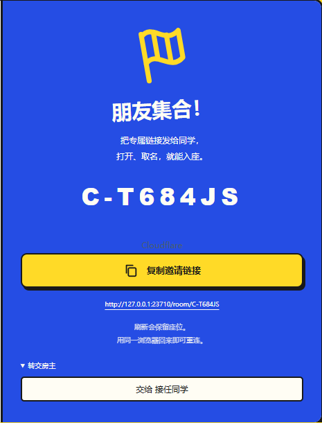
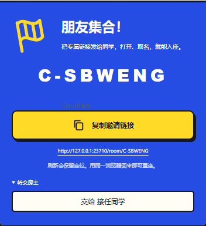

# 转交房主菜单显示修复

点击大厅邀请栏的“转交房主”后，候选按钮使用米白背景，但继承邀请栏的米白文字，导致名单显示为空白框。为 `.transfer-host button` 明确设置 `color: var(--ink)`，使候选名字使用页面正文的深色。

## 必要验证

- 修复前，桌面浏览器回归复现：候选按钮文字为 `rgb(255, 253, 244)`，与背景相同；预期为正文颜色 `rgb(25, 25, 25)`。
- 修复后，本地 Edge 两项浏览器回归通过：1440×1000 桌面、390×844 手机视口。检查展开前后候选的可见性、文字颜色、只列出其他玩家、非房主无转交入口、页面无横向溢出，以及点击候选后服务端房主变更和双方管理入口切换。
- `pnpm exec vite build`、`git diff --check` 通过。
- 定向命令：`pnpm exec playwright test tests/browser/host-transfer.spec.ts`；此文件未加入默认远端浏览器检查列表，CI 配置和范围未修改。

## 实测截图

桌面：

手机浏览器视口：

