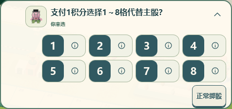
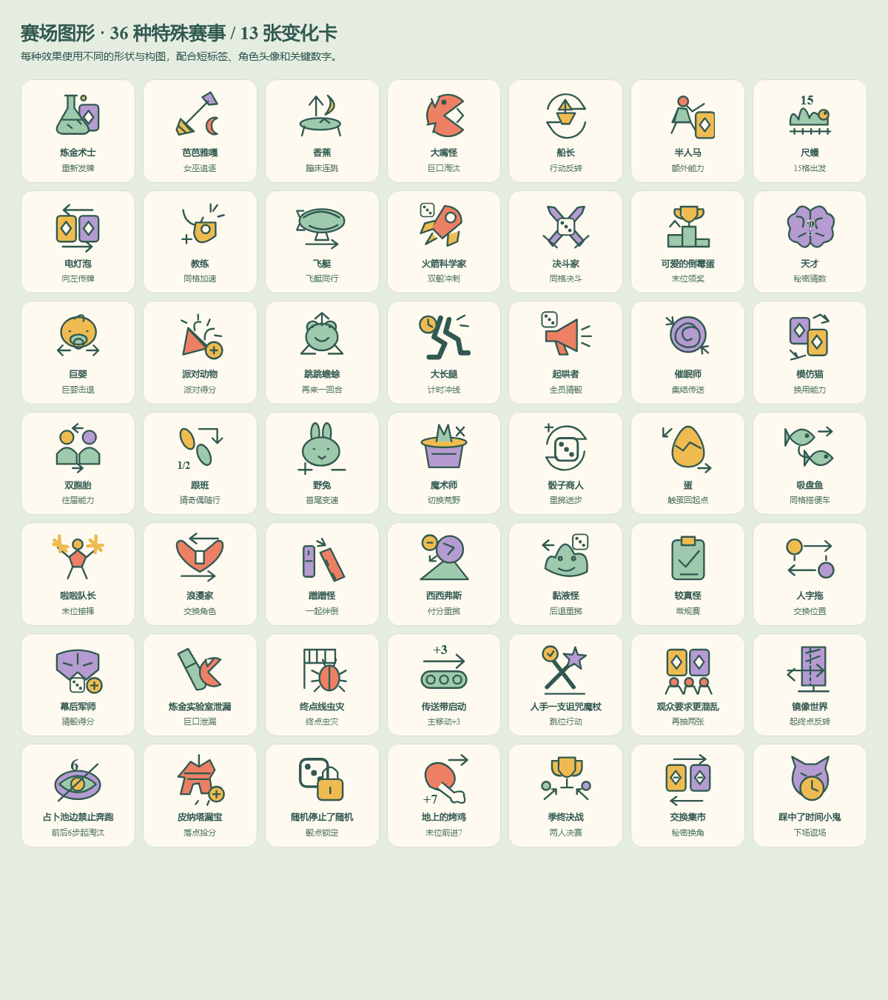

# Immersive race UI — local acceptance, 2026-11-06

Based on `origin/main` at `74b4c22eeaaf53f1bb7396d3b6eeeb8a5cba5ed9` (including the visible room options in PR #54).

The race uses a common SVG toolbar, a small active-player indicator, and compact event chips. Full rules, cumulative scores and public event history open on demand. Numeric choice buttons contain one number; the adjacent information button opens the exact option without submitting it. Shared payment requirements stay in the heading, while varying costs, repeat counts and allocation consequences remain visible beside their numbers. Character and prediction choices use portraits, seat numbers and independent detail controls.

The artwork covers all 36 entries in `src/shared/special-events.ts` and all 13 implemented twist cards. Each has its own SVG composition, tested for distinct shapes after color attributes are removed. These are original SVGs authored in source. Character portraits and 3D models are reused from the repository.

Local verification:

- `pnpm test`: **1,492 passed**, including gameplay, public event replay, pause, persistence and privacy coverage.
- `pnpm typecheck`: source, tests and Worker typechecks passed.
- `pnpm build`: Node client/server and Worker assets built successfully. The existing large-bundle advisory remains.
- Chromium/Edge: the 21-test UI, chat, minimap and HUD suite passed. Additional local checks covered ability grants, private card details, secret guesses, all five pause/resume scenarios, event ordering, two-die results, delayed final settlement, missing public event pages and nearby-character camera shots.
- Room setup: the existing visible-control and custom-map-draft tests passed, including 320–1440 px layouts, packs, special events and preset changes.
- WebKit: the explicit local `playwright.race-ui.config.ts` covers the 18 layout/choice/chat scenarios. It is not referenced by remote CI.

Screenshots reviewed in this directory include desktop, 320/390 px portrait, 568/667/844 px landscape, tablet, event cues, numeric details and chat/keyboard layouts. The keyboard bridge was exercised with simulated `visualViewport` reductions of 260/300 px in portrait and 180 px in landscape. These are browser checks, not physical iPhone/Safari or Android-device acceptance.

The transient cue reads only the active beat in the existing presentation queue. It owns no timers, network subscriptions or action dispatch. Dice retain their existing result-reading window; ability grants retain their public/private projection; skip, refresh and reconnect use the existing baseline policy. Event history is read on demand rather than announced again as a live log. A neutral field marker uses its own art/name, and movement numbers use the real route and race direction.

Pure icon controls have accessible names, visible focus and at least 44 px targets. Opening number details is checked against unchanged room version and pending-choice ID; the same numeric selection still executes the existing game action. Tests also verify that live cues do not overlap the minimap, current operation, roll control or player order.

No engine, server, room protocol, deployment configuration or CI workflow is changed. No remote workflow was manually dispatched. The review branch uses the existing review-only deployment guard and a `[skip ci]` commit.
