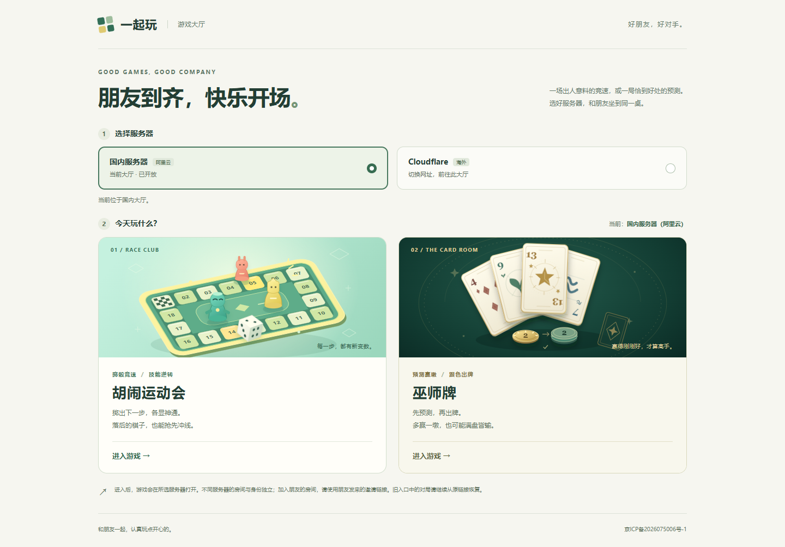
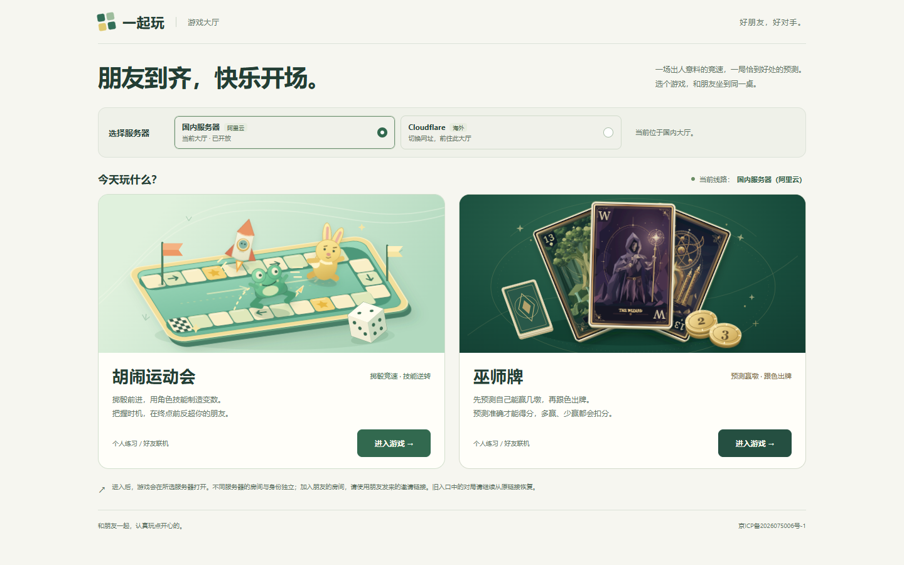

# 「一起玩」大厅视觉与交互验收

日期：2026-11-05。对比基线：`6007ec3`（main）。所有浏览器请求均由本地文件测试替身提供；截图中的正式网址用来验证同源资源和导航形态，没有访问线上房间。

## 设计与实现

保留奶油白 `#f6f6f0`、柔和绿 `#32694f`、薄荷绿 `#c4e7ce`，以深翡翠 `#123e33` 和奶油金衬托巫师牌。两张封面均为 640×360 本地 SVG，使用桌面构图、纸板厚度和柔和投影。统一使用系统中文字族，无外部字体。

设计采用已安装的 frontend-design Skill。参考 [Jackbox Megapicker](https://www.jackboxgames.com/the-jackbox-megapicker) 的独立封面表现，以及 [Board Game Arena](https://boardgamearena.com/gamelist) 的游戏入口层级。[Kenney Board Game Pack](https://kenney.nl/assets/boardgame-pack) 的 CC0 许可已核对；本轮采用项目现有设计与原创矢量，没有引入该素材包或其他第三方插画。牌面的来源、原文件哈希见 [美术说明](../../../lobby/art/README.md)。

- 运动会：按游戏现有薄荷棋盘及兔子、跳跳蛙、火箭科学家原型重绘，加入冲线、跃迁轨迹与技能细节。前景骰子单独响应悬停、键盘焦点和触屏按下，地面投影保持静止。
- 巫师牌：真实复用绿色13、巫师与黄色13 SVG 牌面，展开层叠，配合标记 2、3 的预测赢墩筹码。SVG ID 均加前缀，无外部资源引用。
- 顶部移除装饰性英文、序号与多余留白，服务器区缩成一条紧凑选择栏。标题、玩法、练习/联机信息及实色入口按钮各有明确层级。整卡仍是单个原生链接，没有嵌套交互控件。
- 桌面以双列展示；手机以完整 16:9 封面纵向展示两款游戏，避免原来的窄幅裁切。横屏允许自然纵向滚动。卡片悬停上浮与阴影变化仅用于精确指针，减少动效时关闭移动与过渡。

没有修改 `lobby/app.mjs`、`routing.mjs`、`config.json`、两个游戏的玩法/后端或部署文件。两个原有 SVG 文件名继续符合国内 Nginx 白名单；构建仍按原方式复制到两端大厅。服务器切换仍前往对应大厅网址，邀请继续固定原服、房间与观战身份。

## 前后对比

| 检查项 | 优化前 | 优化后 |
| --- | --- | --- |
| 1366×768 两卡底部位置 | 869.39px，入口未完整进入首屏 | 747.27px，两卡与入口完整显示 |
| 桌面入口可见高度 | 38px，文字链接样式 | 44px，实色按钮样式 |
| 手机封面 | 横向卡片内窄幅裁切 | 完整 16:9 场景 |
| 资源加载及脚本错误 | 0 | 0 |

完整测量：[优化前](before-geometry.json)、[优化后](after-geometry.json)。

| 视口 | 优化前 | 优化后 |
| --- | --- | --- |
| 1440×900 桌面 | [查看](before-1440x900.png) | [查看](after-1440x900.png) |
| 1366×768 桌面 | [查看](before-1366x768.png) | [查看](after-1366x768.png) |
| 390×844 竖屏 | [查看](before-390x844.png) | [查看](after-390x844.png) |
| 320×720 窄屏 | [查看](before-320x720.png) | [查看](after-320x720.png) |
| 844×390 横屏 | [查看](before-844x390.png) | [查看](after-844x390.png) |
| 桌面悬停 | [查看](before-hover.png) | [查看](after-hover.png) |

| 优化前 | 优化后 |
| --- | --- |
|  |  |

截图均为 fullPage：文件可以高于视口，首屏结论以真实矩形测量及测试断言为准。已目视对比桌面、手机和横屏；迭代修正了入口加载时背景过渡造成的短暂低对比，以及骰子从 SVG 图片移入 HTML 后继承默认填色的问题。上面的最终截图已包含修正。

## 本地验证

```powershell
npm run build
npm run typecheck:release
node --import tsx --test tests/lobby.test.ts tests/lobby-resources.test.ts
node node_modules/@playwright/test/cli.js test tests/browser/lobby.spec.ts
node docs/qa/lobby-polish/capture.mjs lobby after
git diff --check
```

- 客户端、Node 服务端、Cloudflare 浏览器构建成功，两端大厅静态资源均已生成。游戏构建的既有大包体提示仍存在，本轮没有修改其分包策略。
- 发布源码与 Worker 类型检查通过；大厅单元及两端资源/国内白名单检查 **6/6** 通过。
- 浏览器 **9/9** 通过：保留原有两服四入口、跨大厅切换、邀请/观战、刷新、存储禁用、配置漂移及错误配置覆盖；新增 7 个布局断点、真实 SVG 解码、文字与按钮不重叠、44px 入口、桌面首屏、骰子悬停/复位/键盘/减少动效、触屏上下文四入口点击。
- 截图脚本检查 5 个视口并记录 href、矩形及错误；两张 SVG 均在浏览器实际解码。巫师 SVG 的 257 个 ID 无重复，1394 个引用均可解析。
- 未增加依赖、远端 workflow 或手动触发 CI。分支使用既有 `codex/review-only/` 约定和 `[skip ci]` 提交，沿用仓库现有的评审分支保护方式；正常 main 发布流程没有改动。合并时应移除 squash 提交中的 `[skip ci]`，让现有 main 自动发布正常执行。

截图可通过 `capture.mjs <大厅源码目录> before|after` 重建；基线源码可从 `6007ec3` 的 `lobby/` 导出。当前机器的 node_modules 为共享 junction，`pnpm exec` 会尝试重装并被路径保护拒绝，因此上面使用已有依赖的直接 Node CLI 与 npm scripts，没有重装或更改依赖。

设备验证为本机 Edge 与移动/触屏浏览器模拟；未将其视为实体 iPhone/Safari 或线上生产验收。此 PR 保持未合并、未部署。
