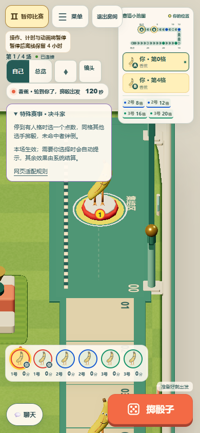
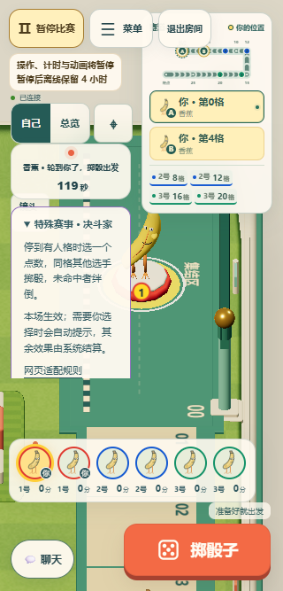
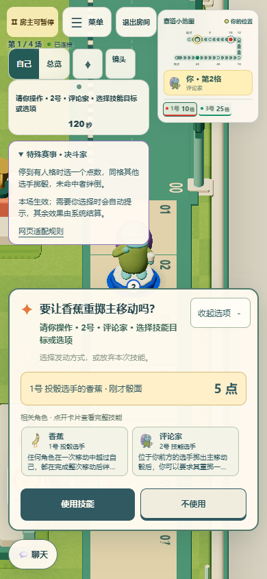
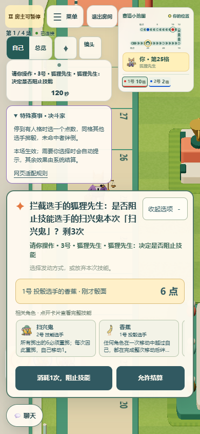
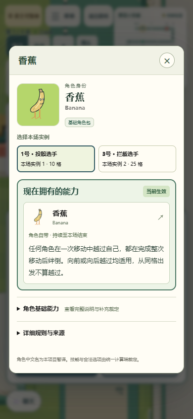

# 手机特殊赛事布局与技能选择提示

手机房主界面增加暂停说明后，倒计时状态条下移到了 162px，特殊赛事仍固定在 145px，导致赛事标题被覆盖。手机端改为在小地图旁按内容高度依次排列状态条和地图规则/特殊赛事；长提示换行时，赛事面板自动下移。

技能选择面板现在显示所参考角色刚才的骰面，包括评价家要求重掷、宿敌跟掷、狐狸拦截、支付重掷和三角人打断投骰等窗口。提示取自当前选择保存的骰面或对应的公开投骰事件；不会把上一轮的 `lastRoll` 当作当前结果。收起面板后仍可查看骰点，刷新也能恢复。

相关角色以横向单行小卡片展示，每张仅两行技能摘要；一排低于 105px。点击打开现有角色详情，可看完整卡片与当前公开能力。已有目标选项显示过能力的角色不重复占位；查看详情不提交选择、不改变房间版本。

这些提示通过既有私有 pending 投影发送，只有当前响应者收到。未揭晓的决斗/对抗骰、秘密猜数和私有卡牌继续使用原来的信息边界。没有修改规则引擎、随机数、结算、计时和 CI 工作流。

## 验证

| 检查 | 结果 |
| --- | --- |
| `pnpm typecheck` | 通过 |
| `pnpm test` | 1450/1450 通过 |
| `pnpm build` | Node 客户端/服务端与浏览器 Worker 产物构建通过 |
| `pnpm exec wrangler deploy --dry-run` | 通过，未部署 |
| 六个相关浏览器文件联合运行 | 18/18 通过，约 1.3 分钟 |

浏览器范围：`race-hud-layout`、`choice-dice-hints`、`choice-ability-hints`、`interaction-feedback`、`chat-layout`、`special-events`。覆盖 1440px 桌面，430/390/320px 手机，房主/客人、状态换行、事件收放、真实掷骰与跳过、技能响应、刷新、相关角色卡片展开、聊天和键盘避让。最后补充两种新界面的 3 项定向复验及最终截图。

投影回归另覆盖：旧骰点污染、连续评价家重掷更新、其他技能骰插入后保留宿敌目标骰、投骰前不显示历史值、原始投骰暂停在三角人窗口、多骰、序列化恢复、只读投影和秘密对抗保护。

## 截图

390px 房主：状态条与特殊赛事分别显示，小地图仍完整。

320px 窄屏：状态换行后赛事继续向下排列。

评价家：直接看到对方 5 点，相关角色技能以小卡片展示。

狐狸：显示当前的 6 点、扫兴鬼和投骰角色，可横向查看更多相关角色。

点击相关角色放大查看卡片。

其他证据： [客人](guest-390.png)、[投骰演出](host-playback.png)、[桌面比赛](host-1440.png)、[桌面评价家](critic-desktop.png)、[桌面狐狸](fox-desktop.png)。
