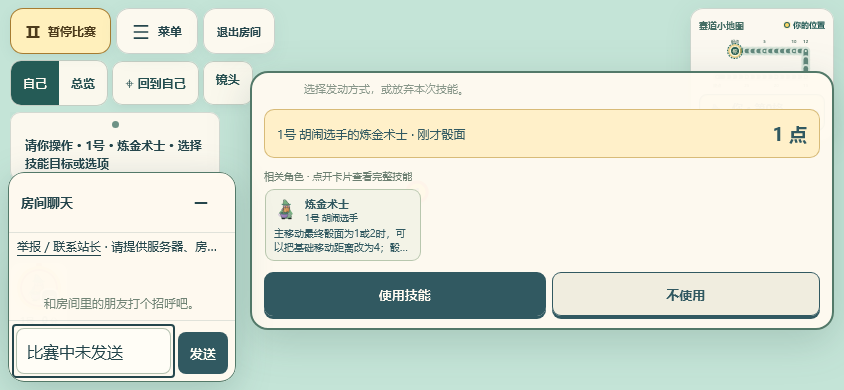
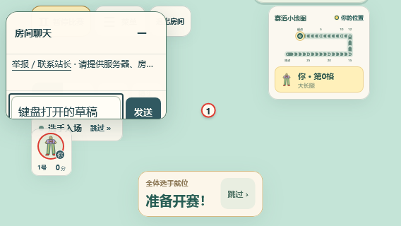

# 一键横屏检查 · 2026-11-05

基于最新 main `8253f5dbae87f91b9f88f43b26ccb644ec65b486`，独立分支 `codex/review-only/mobile-landscape`。取代[上一轮方向设置弹窗](../room-orientation/README.md)的交互，建房与玩法设置沿用当前主分支。

## 玩家看到的行为

手机的页首及比赛菜单提供「横屏 / 退出横屏」，没有方向选择弹窗、竖屏锁定选项或全屏复选框。点击时先申请整个文档全屏，再调用 `screen.orientation.lock('landscape')`；加载、设备旋转、键盘高度变化和回到页面均不自动申请。

退出只解除本次锁定、退出本次开启的全屏，不强制锁回竖屏，也不关闭玩家原先已有的全屏。浏览器自行退出、取消未完成请求、请求迟到、退出失败后重试或浏览器自行退出均会清理本次状态。按钮与现有菜单、聊天和游戏树相互独立，动态创建的菜单也显示当前状态。

API 缺失、全屏权限关闭或请求被拒绝时，不保留无效的横屏按钮，原位简短提示关闭系统竖屏锁定后手动旋转。默认及退出后继续按真实视口自动布局。桌面鼠标界面隐藏手机方向控件。

## 页面内横向备用方案的评估

本轮工程判断是不加入页面整体 `rotate(90deg)`：比赛使用真实视口的布局与三维场景，聊天通过 `createPortal` 放到 body，键盘通过 `visualViewport` 测量，菜单/角色详情和安全区各有定位边界。旋转一个容器不能同时改变媒体查询、系统键盘方向和安全区方向；变换还会影响固定定位元素的包含块。若另做坐标映射和门户旋转，需要专门的跨设备实现与验收，不能把简单变换当作可靠后备。

保留未变换的触摸、滚动和实际横竖屏布局，提供明确的手动旋转提示，不承诺网页能绕过系统方向锁定。依据：[Screen Orientation](https://www.w3.org/TR/screen-orientation/)、[Fullscreen API](https://fullscreen.spec.whatwg.org/)、[CSS Transforms 的渲染模型](https://www.w3.org/TR/css-transforms-1/#transform-rendering)。

## 本地证据

Windows，Node 26.13.0，Playwright 1.64.1；Chromium 使用 Edge 156.0.4314.58，WebKit 使用 Playwright WebKit 27.2。

| 检查 | 结果 |
| --- | --- |
| `pnpm typecheck`（含测试和 Worker） | 通过 |
| `pnpm build`（Node / browser 两份构建） | 通过，保留原大分包提醒 |
| 本地方向和界面专项 | Chromium 23 通过；WebKit 22 通过、1 项跳过 |
| 跳过项 | WebKit 移动模拟上下文 `fullscreenEnabled=false`，无法执行原生全屏项 |

方向专项覆盖直接进入/退出、缺少 orientation/lock/fullscreen、全屏策略关闭、权限拒绝、连续切换、未完成锁定和全屏的取消、迟到结果、原有全屏所有权、浏览器退出/替换全屏、退出拒绝与重试、pagehide 清理。Chromium 另以原生 Fullscreen API 和测试模态菜单核对全屏后的可见性和退出；该项的方向锁仍用替身。WebKit 的 API 成功/失败路径使用替身。

真实本地 Node 房间检查覆盖建房草稿、房间配置及展开状态、仅一次建房请求、原 socket 身份及版本不变；完整练习选角流程、选中角色卡、角色详情、比赛技能选择、聊天草稿、八人 HUD/镜头、计分审计展开与比赛结算。期间实际触发新按钮进出横屏，并触摸选择和操作；核对无横向溢出、关键按钮命中正确、无误操作或额外游戏动作。

视口覆盖 390×844 ↔ 844×390、375×667 ↔ 667×375、320×568 ↔ 568×320、360×800 ↔ 800×360、430×932 ↔ 932×430 及 1440×900。安全区使用左右 44px、底部 21px 的样式替身；键盘通过 `visualViewport` 替身模拟剩余 190/210/270/300/400px 等高度，并聚焦输入，断言输入框和发送按钮完整处于剩余可见区内。检查发现主分支新举报说明在短聊天栏挤出发送区，现将其压为单行省略，保留完整 DOM 文本与联系入口。

复现：

```sh
pnpm typecheck
pnpm build
pnpm exec playwright test -c playwright.room-experience.config.ts
```

这些是桌面浏览器内核、移动视口和 API 替身检查。未进行实体 Android/iPhone、iOS Safari、真实系统方向锁、软键盘/输入法、刘海和浏览器工具栏的验证，也未在线部署。没有新增 CI 工作流、job 或远端浏览器矩阵，没有手动触发远端 CI。审查分支沿用 `[skip ci]` 和 review-only 保护；合并消息移除跳过标记后走原有 main 流程。

## 截图




