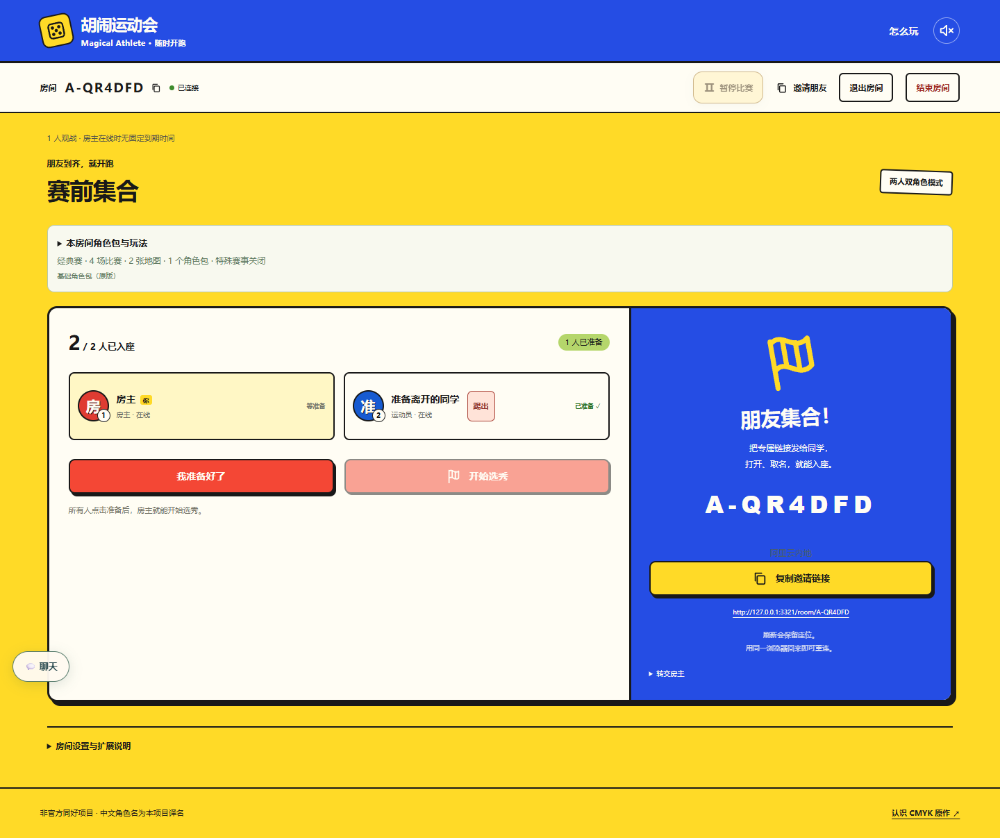
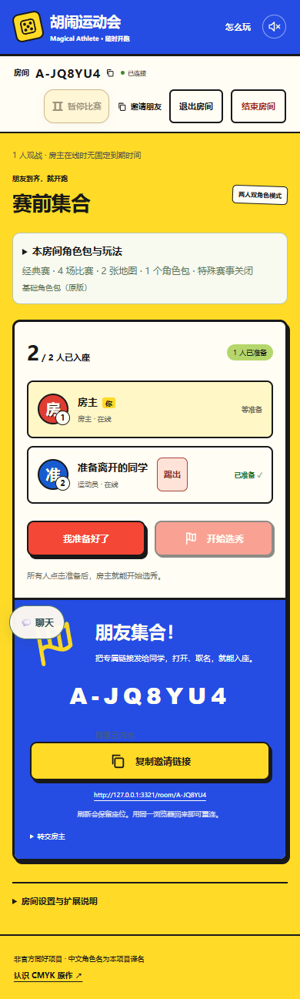
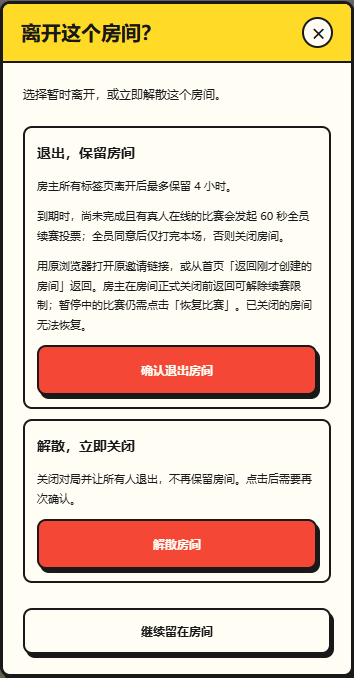

# 房间管理本地验收

2026-10-28。行为说明见[房间使用说明](../../../README.md)。Cloudflare 使用本地 HTTPS Worker，阿里云使用临时 Node 实例；以下结果均为本地验证。

| 检查 | 结果 |
| --- | --- |
| `pnpm typecheck` | 通过 |
| `pnpm test` | 1441/1441，通过 |
| `pnpm build` | 通过，保留已有的大体积 chunk 提示 |
| `pnpm exec wrangler deploy --dry-run --outdir .local/room-management-worker-dry-run` | 通过，仅打包预检 |
| `pnpm exec playwright test tests/browser/room-pause.spec.ts tests/browser/room-continuation.spec.ts` | 7/7，通过 |
| `pnpm exec playwright test -c playwright.room-management.config.ts` | 4/4，通过，覆盖两种后端的桌面和手机 |

单元回归覆盖踢人权限、自踢/观战/开赛后拒绝、席位释放与旧身份失效、事务失败重试、暂停固定截止、存档恢复、房主返回与最后一票交错，以及到期关闭后不能复活。已有浏览器回归验证选卡、骰子阅读、技能选择、真人决斗、六骰、入场动画和续赛结果展示。

双端浏览器专项只走大厅与选秀，验证取消/确认踢人、旧凭据返回401、成员通知、暂停确认、离线期限提示、首页原身份返回及恢复比赛。没有增加完整多人对局测试；独立配置仅供本地显式运行，未修改远端工作流或原有测试选择。

4小时边界使用受控时钟及重启测试覆盖，未做线上墙钟等待实测。旧浏览器主持存档保留原有计算页面在线限制。主动断开 Worker 连接时开发运行时会打印 `Network connection lost`，上述专项全部通过，浏览器 `pageerror` 为空。未部署、合并或修改线上配置。

## 界面证据

截图来自本地阿里云适配器；两种后端均通过相同浏览器断言。已核对文字颜色、手机横向溢出及确认/取消行为。

### 桌面大厅

### 手机大厅

### 手机暂停退出提示

