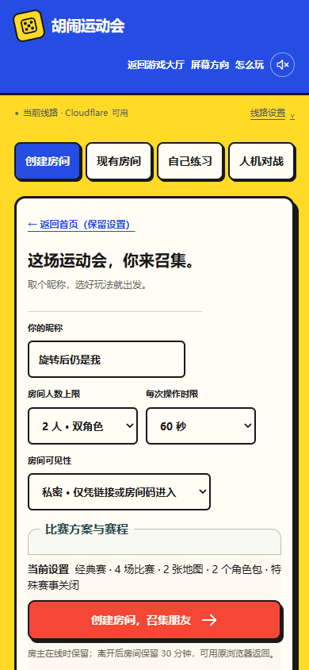
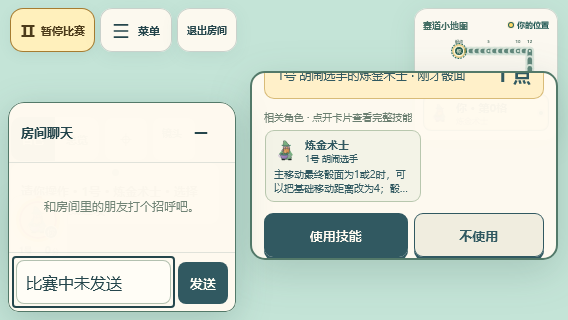
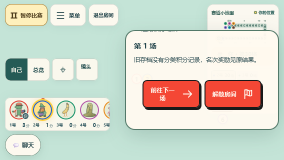
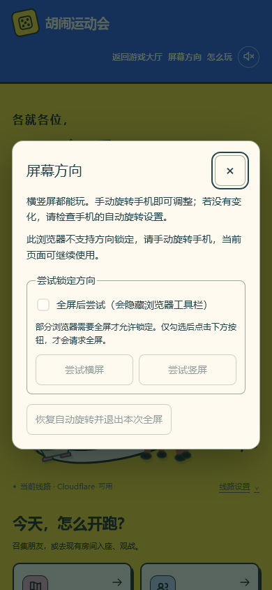

# 建房与手机方向检查 · 2026-11-05

基于 main `b667e03d8a380f7597d40b61686088cc100ac05f`。开始时所有已有工作区均干净；在独立工作区实现，没有改动原分支。保留首页四入口、双角色底栏、HUD/聊天、邀请与恢复流程。只调整界面与本地测试，不修改部署、线路选择、规则或计时。

建房时收起首页插画，把入口压成短页签；昵称、人数、时限和可见性优先展示。比赛方案保持可选，角色包、特殊赛事、逐场积分按需展开，当前设置与创建按钮集中到底部。非官方扩展、Second Wind 尚待逐卡核对、Box 暂不可用、平衡性限制和房间保留提示继续保留。

手机横屏采用真实响应式布局；聊天、HUD、技能选择和赛场操作各自保留空间。短竖屏及键盘出现时，沿用已有 visualViewport 监听调整聊天可用高度。旋转只改变布局，不替换组件、不操作网络或提交游戏动作。

## 方向控制

首页/房间页和比赛菜单提供同一个“屏幕方向”面板。默认支持手动旋转，竖屏继续可玩。仅点击“尝试横屏/竖屏”才调用方向锁定；仅明确勾选“全屏后尝试”后再点击，才请求全屏。功能检测失败或请求被拒绝时显示手动旋转提示。恢复按钮解除锁定并退出本次进入的全屏，保留用户原有全屏；外部退出全屏、取消未完成请求及退出失败重试均有检查。无页面 CSS 旋转，无 resize/orientationchange 网络副作用。

兼容性取决于浏览器、系统设置及其前置条件，依据 [W3C Screen Orientation](https://www.w3.org/TR/screen-orientation/)；不能把 API 存在当作一定能够锁定。

## 实际本地验证

Windows，Node `26.13.0`、Playwright `1.64.1`；Chromium 使用 Edge `156.0.4314.58`，WebKit 为 Playwright `27.2`，不是 iOS Safari。

| 检查 | 结果 |
| --- | --- |
| 全套单元/集成测试 | 1,471 / 1,471 |
| 主项目及 Worker TypeScript | 通过 |
| Node/Browser 前端及服务端构建 | 通过；保留原有大分包提醒 |
| 新方向与布局浏览器专项 | Chromium 10 + WebKit 10，通过 |
| 旧首页、双角色选角、练习、成绩操作回归 | Chromium 8 + WebKit 8，通过 |

旧回归的一次批量执行中，Chromium 320px 用例出现浏览器 `Target crashed`；其余 15 项通过，该用例独立复验 1/1 通过。上述旧回归结果为分次执行结果，新专项 20 项在同一轮全部通过。

浏览器专项覆盖 390×844 ↔ 844×390、375×667 ↔ 667×375、320×568 ↔ 568×320、360×800 ↔ 800×360、430×932 ↔ 932×430，以及 1440×900；同一页连续切换多次。校验建房请求仅一次、房间 socket ID 不变、配置/折叠状态/聊天草稿/选牌/角色弹窗/比赛菜单保留、合法技能选择与按钮命中、八人赛场及成绩滚动。WebKit 首页装饰造成的 1px 页面溢出已修正。

安全区以 CSS 环境变量替身模拟左右 44px、底部 21px；旧双角色用例的底部 34px 在 Chromium 使用 CDP，在 WebKit 替换同一环境变量。键盘使用 visualViewport 事件替身及 390×300 的布局视口收缩，包含横屏剩余 190/210px。方向 API 的成功、缺失、拒绝、全屏拒绝、退出失败、并发点击和未完成请求取消均使用替身核对调用顺序；没有把替身结果称为设备锁屏验证。

复现（先构建）：

```sh
npm test
node node_modules/typescript/bin/tsc --noEmit
node node_modules/typescript/bin/tsc --noEmit -p tsconfig.worker.json
npm run build
node node_modules/@playwright/test/cli.js test -c playwright.room-experience.config.ts
```

旧回归使用原 `tests/browser/home-entry.spec.ts`、`duo-practice-upgrade.spec.ts`，分别用 Chromium 和 WebKit 执行首页两例、四种双角色宽度、练习与成绩操作。为适配折叠控件和 WebKit，测试等待初始连接/焦点及操作回执，并以样式环境变量替代 Chromium 专有的 CDP；不改变产品规则。

## 未覆盖

未实测实体 iPhone/Android、iOS Safari、厂商浏览器、真实系统方向锁/全屏权限、系统键盘/输入法、真实刘海/浏览器工具栏、PWA 或移动网络。本地 Node 房间与 API 替身不代表线上/真机验收。未新增工作流或手动远端 CI，PR 使用既有 review-only 分支和 `[skip ci]`；合并消息移除该标记后走原 main 流程。

## 截图





