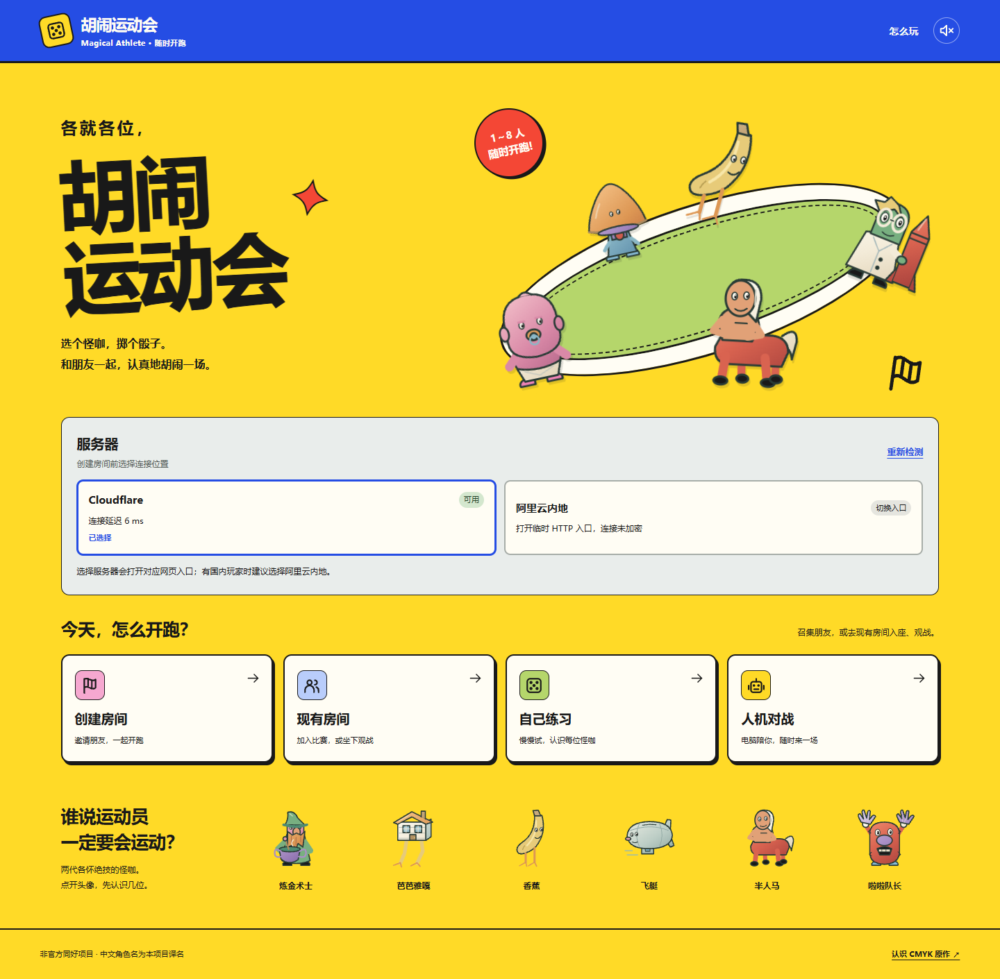
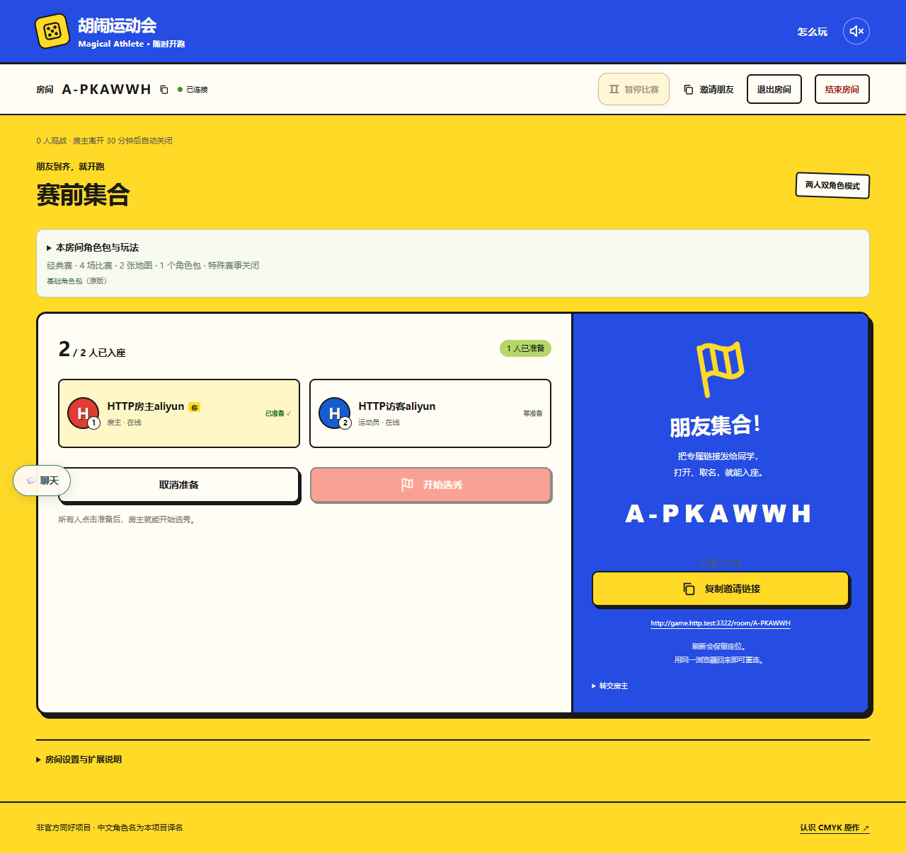
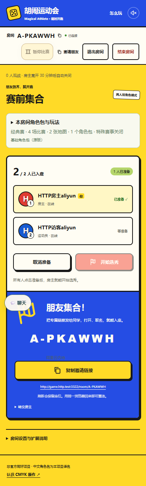

# 双服务器网页入口切换验收

本次修复选服后网页仍停在原入口的问题：新建和加入在目标服务器的网页完成，网页资源、API、实时连接使用目标入口。地址仅取自同源受信 `/backends.json`，没有增加正式或 Preview 地址的客户端硬编码。实现及身份兼容约束统一见[双后端接入说明](../../dual-backend-deployment.md)。

## 本地结果

- `pnpm test`：1415/1415 通过，包含原有规则、鉴权、幂等回执、配额和持久化回归；最终定向后端/身份/部署配置 27/27 也通过。
- `pnpm typecheck`、`pnpm build`（Node 与 Worker 两套完整网页）、`pnpm exec wrangler deploy --dry-run --outdir tmp/server-entry-switch-worker` 通过。
- `CI=true pnpm exec playwright test tests/browser/dual-backend.spec.ts tests/browser/home-entry.spec.ts --reporter=list --output=test-results/server-entry-home`：17/17，通过时间 26.4 秒。
- `CI=true pnpm exec playwright test -c playwright.dual.config.ts --reporter=list --output=test-results/server-entry-dual`：10/10，通过时间 51.7 秒。
- 桌面及 390px 手机截图已目视核对，页面无横向溢出。真实双入口用例没有浏览器 `pageerror`。

## 验收对应

| 要求 | 自动化证据 |
| --- | --- |
| Cloudflare HTTPS → 阿里云 HTTP；反向切换 | `http-entry.spec.ts` 两个独立会话用例：真实本地 Worker HTTPS 与普通主机名 Node HTTP，点击选服后断言地址再建房、加入、准备与聊天 |
| 同服不刷新，无循环；旧偏好不拉回另一服 | `dual-backend.spec.ts`：导航哨兵保留、邀请恰好两次文档请求、当前入口优先于旧偏好 |
| HTTPS 页中的 HTTP 入口仍可点击 | 只显示“切换入口”，点击前没有 HTTP API/实时探测；通过顶层导航进入，不标成下线 |
| 错误入口的邀请保留房间码 | 两方向均从错误入口打开完整前缀链接；目标 URL 保留房间码，丢弃查询与片段；新入口不继承昵称或 Token |
| 阿里云不依赖 Cloudflare | 到达 HTTP 入口后阻断 CF 的 HTTP/WSS，仍能建房、加入、准备、聊天、房主与访客刷新、访客离线重连；刷新后的 JS/CSS 及其他 HTTP 请求全部来自 Aliyun 测试入口。另一个被阻断 CF 的用例实际选卡、锁定、合法掷骰并启动 AI |
| 已有身份与存档 | 独立测试注入真实 Worker 返回的旧跨入口身份，留在原网页用原凭据恢复、准备、刷新、从首页返回；Token、座位和准备状态保持，邀请地址使用房间的真实入口。局内不展示切服控件 |
| 旧六位码与未确认建房 | 无明确归属仍需选服；两端同码身份和角色隔离回归保留。未确认回执禁止切服，原入口按相同请求编号与请求体重试 |
| 正式/Preview 隔离 | 独立 Preview Worker 状态目录、单房配额和 Node 实例，两方向切换、建房、邀请、加入与刷新；所有请求均未进入正式测试 origin，正式 origin 预存身份保持原样且 Preview 无法读取 |

## 验证范围

测试使用本机真实 Worker/Node 构建及独立浏览器上下文。普通 HTTP 测试域名由浏览器解析到 loopback，但属于实际**非安全上下文**，断言 `isSecureContext=false`、`crypto.randomUUID` 不可用，避免 localhost 的安全例外掩盖 HTTP 问题。本地 HTTPS 使用测试证书，仅测试启动器忽略其证书错误。Worker 在主动离线、刷新或关闭 WebSocket 时打印的 `Network connection lost` 不等于恢复失败，恢复断言及浏览器异常检查均通过。

这不是公网新版本发布或国内真实断 VPN 实测。本任务不合并 PR、不手动发布正式环境、不新增 CI 工作流或扩大远端检查范围。现有每端正式 14、共享 Preview 1 的总配额没有修改；游戏引擎、随机数、服务端权威、鉴权 schema 和持久化实现也没有修改。阿里云继续使用临时公网 IP HTTP，未加密提示保留，域名升级单独进行。

## 截图

截图中的地址、房间号与延迟均来自本地测试环境。

