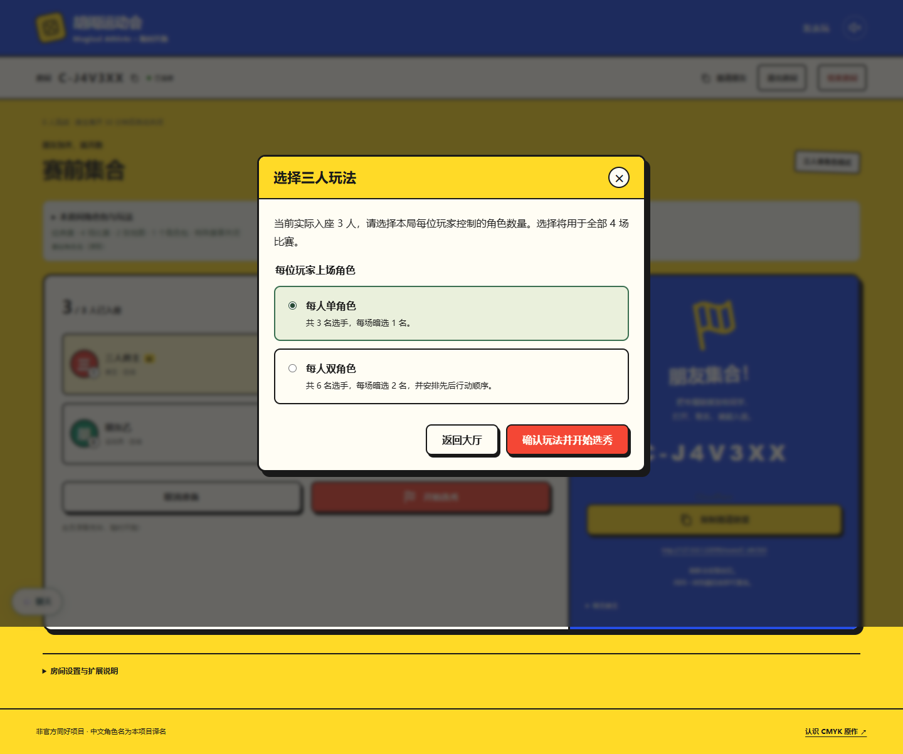
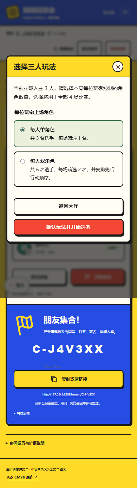
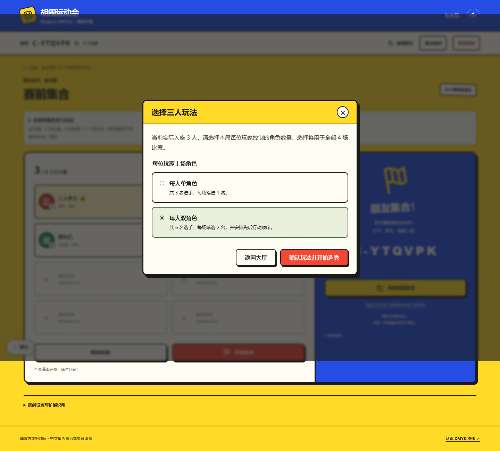
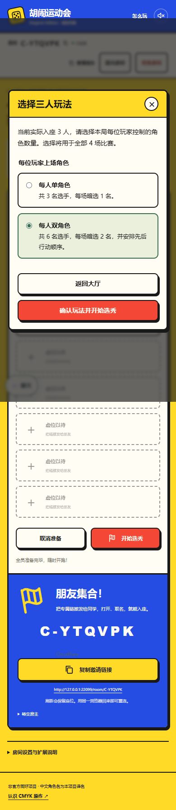

# 三人单／双角色玩法

实际入座三名玩家并全员准备后，房主点击“开始选秀”会先选择“每人单角色”或“每人双角色”。人数上限为三人或四至八人都使用相同入口。取消不开始；弹窗期间人数、准备状态或房主变化会关闭旧选择，服务端也拒绝过期人数与版本。

双角色模式按六名普通选手计算选秀、暗选和技能预留。四场每人八张、四批六张蛇形选秀；六／八场按同一公式扩展。每场两张的选择顺序决定本场行动顺序；下一场先手及黏液怪同控制者豁免沿用项目双角色房规。配置全局冻结并随存档恢复；旧存档没有该字段时保留三人单角色。详细玩法以[公开赛程](../../../public/rules/competition.md)和[网页房规](../../house-rules.md)为准。

## 事件、变化牌与技能适用性

测试使用三名玩家、六枚棋子，区分玩家与选手身份：

| 范围 | 本轮检查 |
| --- | --- |
| 按玩家 | 赛前奖励每人一次、半人马每人抽一张并授予己方两名选手、其他玩家各猜一次及各得一次分、计时标记按在赛玩家去重 |
| 按棋子 | 同格教练计数包括同玩家另一枚棋子；黏液怪按项目双角色房规豁免当前控制者的所有棋子；改变控制权后贷款鲨按当前对手归属发筹码 |
| 实验室／Bonkbug／传送带 | NPC在每枚棋子的回合结束后行动且不占玩家席位；独立判定各棋子落点；传送带处理全部六枚棋子 |
| 诅咒魔杖／观众 | 按六个固定选手席位跳过；观众追加两次抽牌仍过滤公共事件的冲突卡 |
| 镜像／占卜池／皮纳塔 | 反向终点保留物理位置及玩家积分归属；淘汰针对本次修正后主移动的棋子；所有已占棋子格均不放新筹码，领取记入正确玩家账本 |
| 固定骰／烤鸡 | 每名玩家生成一枚固定结果，同控制者两名选手共用；所有并列末位棋子都能前进，包括触发者自己的另一枚棋子 |
| 季终决战／交换集市／时间小鬼 | 同一玩家两名选手可以同时晋级决战，积分只结算一次；每玩家一张私人换牌且三人承诺后统一揭示；下一场可多出第七枚棋子，普通暗选仍各消耗两张 |
| 冲突保护 | 最后两名领奖仍过滤季终决战；反向行动事件仍过滤诅咒魔杖；既有事件与变化牌冲突表继续生效 |

以上涵盖全部13种变化牌的针对性行为；不是全部事件、角色和变化牌的笛卡尔积穷举。另用全部已完成角色包、特殊赛事及多地图完成三人双角色4／6／8场赛程，每场JSON恢复并检查名次、分类积分及累计分数一致。

## 验证与截图

- `tests/three-player-mode.test.ts`：配置、完整赛程、Node房间、旧存档及浏览器计算端恢复。
- `tests/three-player-interactions.test.ts`：18项三人双角色组合回归。
- `tests/relay.test.ts`：4项真实Worker消息处理、3／8人上限、两种玩法、持久化与重复请求。
- `tests/event-matches.test.ts`：在既有全包赛程中加入三人双角色4／6／8场。
- 最终`pnpm test`全部1391／1391通过（23.7秒），包含本轮38项新增回归及既有检查。
- 本地浏览器2项：三人房单角色、八人房实际三人双角色；真实开局消息、取消、人数变化、暗选恢复与保密、交换行动顺序、3／6枚棋子揭示，1440px桌面和390px手机均检查无横向溢出。
- 类型检查、完整构建、Worker dry-run及`git diff --check`通过。CI工作流和远端浏览器范围保持不变，未手动触发额外远端检查。

| 桌面 | 手机 |
| --- | --- |
|  |  |
|  |  |

[手机双角色暗选与固定顺序](double-selection-mobile.png)。截图为本地浏览器，不代表实体手机测试。
